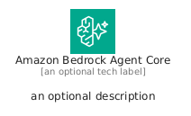
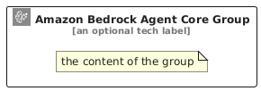

# AmazonBedrockAgentCore


```text
aws/Architecture/ArtificialIntelligence/AmazonBedrockAgentCore
```

```text
include('aws/Architecture/ArtificialIntelligence/AmazonBedrockAgentCore')
```


| Illustration | AmazonBedrockAgentCore | AmazonBedrockAgentCoreCard | AmazonBedrockAgentCoreGroup |
| :---: | :---: | :---: | :---: |
|  |  |  |  |


## Sprites
The item provides the following sriptes:

- `<$AmazonBedrockAgentCoreXs>`
- `<$AmazonBedrockAgentCoreSm>`
- `<$AmazonBedrockAgentCoreMd>`
- `<$AmazonBedrockAgentCoreLg>`


## AmazonBedrockAgentCore

### Load remotely
```plantuml
@startuml
' configures the library
!global $LIB_BASE_LOCATION="https://raw.githubusercontent.com/tmorin/plantuml-libs/master/distribution"

' loads the library's bootstrap
!include $LIB_BASE_LOCATION/bootstrap.puml

' loads the package bootstrap
include('aws/bootstrap')

' loads the Item which embeds the element AmazonBedrockAgentCore
include('aws/Architecture/ArtificialIntelligence/AmazonBedrockAgentCore')

' renders the element
AmazonBedrockAgentCore('AmazonBedrockAgentCore', 'Amazon Bedrock Agent Core', 'an optional tech label', 'an optional description')
@enduml
```

### Load locally
```plantuml
@startuml
' configures the library
!global $INCLUSION_MODE="local"
!global $LIB_BASE_LOCATION="../../.."

' loads the library's bootstrap
!include $LIB_BASE_LOCATION/bootstrap.puml

' loads the package bootstrap
include('aws/bootstrap')

' loads the Item which embeds the element AmazonBedrockAgentCore
include('aws/Architecture/ArtificialIntelligence/AmazonBedrockAgentCore')

' renders the element
AmazonBedrockAgentCore('AmazonBedrockAgentCore', 'Amazon Bedrock Agent Core', 'an optional tech label', 'an optional description')
@enduml
```

## AmazonBedrockAgentCoreCard

### Load remotely
```plantuml
@startuml
' configures the library
!global $LIB_BASE_LOCATION="https://raw.githubusercontent.com/tmorin/plantuml-libs/master/distribution"

' loads the library's bootstrap
!include $LIB_BASE_LOCATION/bootstrap.puml

' loads the package bootstrap
include('aws/bootstrap')

' loads the Item which embeds the element AmazonBedrockAgentCoreCard
include('aws/Architecture/ArtificialIntelligence/AmazonBedrockAgentCore')

' renders the element
AmazonBedrockAgentCoreCard('AmazonBedrockAgentCoreCard', 'Amazon Bedrock Agent Core Card', 'an optional description')
@enduml
```

### Load locally
```plantuml
@startuml
' configures the library
!global $INCLUSION_MODE="local"
!global $LIB_BASE_LOCATION="../../.."

' loads the library's bootstrap
!include $LIB_BASE_LOCATION/bootstrap.puml

' loads the package bootstrap
include('aws/bootstrap')

' loads the Item which embeds the element AmazonBedrockAgentCoreCard
include('aws/Architecture/ArtificialIntelligence/AmazonBedrockAgentCore')

' renders the element
AmazonBedrockAgentCoreCard('AmazonBedrockAgentCoreCard', 'Amazon Bedrock Agent Core Card', 'an optional description')
@enduml
```

## AmazonBedrockAgentCoreGroup

### Load remotely
```plantuml
@startuml
' configures the library
!global $LIB_BASE_LOCATION="https://raw.githubusercontent.com/tmorin/plantuml-libs/master/distribution"

' loads the library's bootstrap
!include $LIB_BASE_LOCATION/bootstrap.puml

' loads the package bootstrap
include('aws/bootstrap')

' loads the Item which embeds the element AmazonBedrockAgentCoreGroup
include('aws/Architecture/ArtificialIntelligence/AmazonBedrockAgentCore')

' renders the element
AmazonBedrockAgentCoreGroup('AmazonBedrockAgentCoreGroup', 'Amazon Bedrock Agent Core Group', 'an optional tech label') {
    note as note
        the content of the group
    end note
}
@enduml
```

### Load locally
```plantuml
@startuml
' configures the library
!global $INCLUSION_MODE="local"
!global $LIB_BASE_LOCATION="../../.."

' loads the library's bootstrap
!include $LIB_BASE_LOCATION/bootstrap.puml

' loads the package bootstrap
include('aws/bootstrap')

' loads the Item which embeds the element AmazonBedrockAgentCoreGroup
include('aws/Architecture/ArtificialIntelligence/AmazonBedrockAgentCore')

' renders the element
AmazonBedrockAgentCoreGroup('AmazonBedrockAgentCoreGroup', 'Amazon Bedrock Agent Core Group', 'an optional tech label') {
    note as note
        the content of the group
    end note
}
@enduml
```

