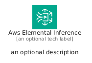
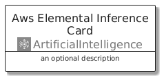
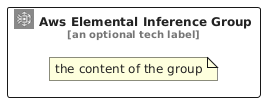

# AwsElementalInference


```text
aws/Architecture/ArtificialIntelligence/AwsElementalInference
```

```text
include('aws/Architecture/ArtificialIntelligence/AwsElementalInference')
```


| Illustration | AwsElementalInference | AwsElementalInferenceCard | AwsElementalInferenceGroup |
| :---: | :---: | :---: | :---: |
|  |  |  |  |


## Sprites
The item provides the following sriptes:

- `<$AwsElementalInferenceXs>`
- `<$AwsElementalInferenceSm>`
- `<$AwsElementalInferenceMd>`
- `<$AwsElementalInferenceLg>`


## AwsElementalInference

### Load remotely
```plantuml
@startuml
' configures the library
!global $LIB_BASE_LOCATION="https://raw.githubusercontent.com/tmorin/plantuml-libs/master/distribution"

' loads the library's bootstrap
!include $LIB_BASE_LOCATION/bootstrap.puml

' loads the package bootstrap
include('aws/bootstrap')

' loads the Item which embeds the element AwsElementalInference
include('aws/Architecture/ArtificialIntelligence/AwsElementalInference')

' renders the element
AwsElementalInference('AwsElementalInference', 'Aws Elemental Inference', 'an optional tech label', 'an optional description')
@enduml
```

### Load locally
```plantuml
@startuml
' configures the library
!global $INCLUSION_MODE="local"
!global $LIB_BASE_LOCATION="../../.."

' loads the library's bootstrap
!include $LIB_BASE_LOCATION/bootstrap.puml

' loads the package bootstrap
include('aws/bootstrap')

' loads the Item which embeds the element AwsElementalInference
include('aws/Architecture/ArtificialIntelligence/AwsElementalInference')

' renders the element
AwsElementalInference('AwsElementalInference', 'Aws Elemental Inference', 'an optional tech label', 'an optional description')
@enduml
```

## AwsElementalInferenceCard

### Load remotely
```plantuml
@startuml
' configures the library
!global $LIB_BASE_LOCATION="https://raw.githubusercontent.com/tmorin/plantuml-libs/master/distribution"

' loads the library's bootstrap
!include $LIB_BASE_LOCATION/bootstrap.puml

' loads the package bootstrap
include('aws/bootstrap')

' loads the Item which embeds the element AwsElementalInferenceCard
include('aws/Architecture/ArtificialIntelligence/AwsElementalInference')

' renders the element
AwsElementalInferenceCard('AwsElementalInferenceCard', 'Aws Elemental Inference Card', 'an optional description')
@enduml
```

### Load locally
```plantuml
@startuml
' configures the library
!global $INCLUSION_MODE="local"
!global $LIB_BASE_LOCATION="../../.."

' loads the library's bootstrap
!include $LIB_BASE_LOCATION/bootstrap.puml

' loads the package bootstrap
include('aws/bootstrap')

' loads the Item which embeds the element AwsElementalInferenceCard
include('aws/Architecture/ArtificialIntelligence/AwsElementalInference')

' renders the element
AwsElementalInferenceCard('AwsElementalInferenceCard', 'Aws Elemental Inference Card', 'an optional description')
@enduml
```

## AwsElementalInferenceGroup

### Load remotely
```plantuml
@startuml
' configures the library
!global $LIB_BASE_LOCATION="https://raw.githubusercontent.com/tmorin/plantuml-libs/master/distribution"

' loads the library's bootstrap
!include $LIB_BASE_LOCATION/bootstrap.puml

' loads the package bootstrap
include('aws/bootstrap')

' loads the Item which embeds the element AwsElementalInferenceGroup
include('aws/Architecture/ArtificialIntelligence/AwsElementalInference')

' renders the element
AwsElementalInferenceGroup('AwsElementalInferenceGroup', 'Aws Elemental Inference Group', 'an optional tech label') {
    note as note
        the content of the group
    end note
}
@enduml
```

### Load locally
```plantuml
@startuml
' configures the library
!global $INCLUSION_MODE="local"
!global $LIB_BASE_LOCATION="../../.."

' loads the library's bootstrap
!include $LIB_BASE_LOCATION/bootstrap.puml

' loads the package bootstrap
include('aws/bootstrap')

' loads the Item which embeds the element AwsElementalInferenceGroup
include('aws/Architecture/ArtificialIntelligence/AwsElementalInference')

' renders the element
AwsElementalInferenceGroup('AwsElementalInferenceGroup', 'Aws Elemental Inference Group', 'an optional tech label') {
    note as note
        the content of the group
    end note
}
@enduml
```

