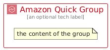

# AmazonQuick


```text
aws/Architecture/BusinessApplications/AmazonQuick
```

```text
include('aws/Architecture/BusinessApplications/AmazonQuick')
```


| Illustration | AmazonQuick | AmazonQuickCard | AmazonQuickGroup |
| :---: | :---: | :---: | :---: |
|  |  |  |  |


## Sprites
The item provides the following sriptes:

- `<$AmazonQuickXs>`
- `<$AmazonQuickSm>`
- `<$AmazonQuickMd>`
- `<$AmazonQuickLg>`


## AmazonQuick

### Load remotely
```plantuml
@startuml
' configures the library
!global $LIB_BASE_LOCATION="https://raw.githubusercontent.com/tmorin/plantuml-libs/master/distribution"

' loads the library's bootstrap
!include $LIB_BASE_LOCATION/bootstrap.puml

' loads the package bootstrap
include('aws/bootstrap')

' loads the Item which embeds the element AmazonQuick
include('aws/Architecture/BusinessApplications/AmazonQuick')

' renders the element
AmazonQuick('AmazonQuick', 'Amazon Quick', 'an optional tech label', 'an optional description')
@enduml
```

### Load locally
```plantuml
@startuml
' configures the library
!global $INCLUSION_MODE="local"
!global $LIB_BASE_LOCATION="../../.."

' loads the library's bootstrap
!include $LIB_BASE_LOCATION/bootstrap.puml

' loads the package bootstrap
include('aws/bootstrap')

' loads the Item which embeds the element AmazonQuick
include('aws/Architecture/BusinessApplications/AmazonQuick')

' renders the element
AmazonQuick('AmazonQuick', 'Amazon Quick', 'an optional tech label', 'an optional description')
@enduml
```

## AmazonQuickCard

### Load remotely
```plantuml
@startuml
' configures the library
!global $LIB_BASE_LOCATION="https://raw.githubusercontent.com/tmorin/plantuml-libs/master/distribution"

' loads the library's bootstrap
!include $LIB_BASE_LOCATION/bootstrap.puml

' loads the package bootstrap
include('aws/bootstrap')

' loads the Item which embeds the element AmazonQuickCard
include('aws/Architecture/BusinessApplications/AmazonQuick')

' renders the element
AmazonQuickCard('AmazonQuickCard', 'Amazon Quick Card', 'an optional description')
@enduml
```

### Load locally
```plantuml
@startuml
' configures the library
!global $INCLUSION_MODE="local"
!global $LIB_BASE_LOCATION="../../.."

' loads the library's bootstrap
!include $LIB_BASE_LOCATION/bootstrap.puml

' loads the package bootstrap
include('aws/bootstrap')

' loads the Item which embeds the element AmazonQuickCard
include('aws/Architecture/BusinessApplications/AmazonQuick')

' renders the element
AmazonQuickCard('AmazonQuickCard', 'Amazon Quick Card', 'an optional description')
@enduml
```

## AmazonQuickGroup

### Load remotely
```plantuml
@startuml
' configures the library
!global $LIB_BASE_LOCATION="https://raw.githubusercontent.com/tmorin/plantuml-libs/master/distribution"

' loads the library's bootstrap
!include $LIB_BASE_LOCATION/bootstrap.puml

' loads the package bootstrap
include('aws/bootstrap')

' loads the Item which embeds the element AmazonQuickGroup
include('aws/Architecture/BusinessApplications/AmazonQuick')

' renders the element
AmazonQuickGroup('AmazonQuickGroup', 'Amazon Quick Group', 'an optional tech label') {
    note as note
        the content of the group
    end note
}
@enduml
```

### Load locally
```plantuml
@startuml
' configures the library
!global $INCLUSION_MODE="local"
!global $LIB_BASE_LOCATION="../../.."

' loads the library's bootstrap
!include $LIB_BASE_LOCATION/bootstrap.puml

' loads the package bootstrap
include('aws/bootstrap')

' loads the Item which embeds the element AmazonQuickGroup
include('aws/Architecture/BusinessApplications/AmazonQuick')

' renders the element
AmazonQuickGroup('AmazonQuickGroup', 'Amazon Quick Group', 'an optional tech label') {
    note as note
        the content of the group
    end note
}
@enduml
```

