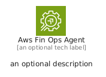
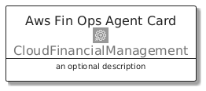
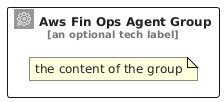

# AwsFinOpsAgent


```text
aws/Architecture/CloudFinancialManagement/AwsFinOpsAgent
```

```text
include('aws/Architecture/CloudFinancialManagement/AwsFinOpsAgent')
```


| Illustration | AwsFinOpsAgent | AwsFinOpsAgentCard | AwsFinOpsAgentGroup |
| :---: | :---: | :---: | :---: |
|  |  |  |  |


## Sprites
The item provides the following sriptes:

- `<$AwsFinOpsAgentXs>`
- `<$AwsFinOpsAgentSm>`
- `<$AwsFinOpsAgentMd>`
- `<$AwsFinOpsAgentLg>`


## AwsFinOpsAgent

### Load remotely
```plantuml
@startuml
' configures the library
!global $LIB_BASE_LOCATION="https://raw.githubusercontent.com/tmorin/plantuml-libs/master/distribution"

' loads the library's bootstrap
!include $LIB_BASE_LOCATION/bootstrap.puml

' loads the package bootstrap
include('aws/bootstrap')

' loads the Item which embeds the element AwsFinOpsAgent
include('aws/Architecture/CloudFinancialManagement/AwsFinOpsAgent')

' renders the element
AwsFinOpsAgent('AwsFinOpsAgent', 'Aws Fin Ops Agent', 'an optional tech label', 'an optional description')
@enduml
```

### Load locally
```plantuml
@startuml
' configures the library
!global $INCLUSION_MODE="local"
!global $LIB_BASE_LOCATION="../../.."

' loads the library's bootstrap
!include $LIB_BASE_LOCATION/bootstrap.puml

' loads the package bootstrap
include('aws/bootstrap')

' loads the Item which embeds the element AwsFinOpsAgent
include('aws/Architecture/CloudFinancialManagement/AwsFinOpsAgent')

' renders the element
AwsFinOpsAgent('AwsFinOpsAgent', 'Aws Fin Ops Agent', 'an optional tech label', 'an optional description')
@enduml
```

## AwsFinOpsAgentCard

### Load remotely
```plantuml
@startuml
' configures the library
!global $LIB_BASE_LOCATION="https://raw.githubusercontent.com/tmorin/plantuml-libs/master/distribution"

' loads the library's bootstrap
!include $LIB_BASE_LOCATION/bootstrap.puml

' loads the package bootstrap
include('aws/bootstrap')

' loads the Item which embeds the element AwsFinOpsAgentCard
include('aws/Architecture/CloudFinancialManagement/AwsFinOpsAgent')

' renders the element
AwsFinOpsAgentCard('AwsFinOpsAgentCard', 'Aws Fin Ops Agent Card', 'an optional description')
@enduml
```

### Load locally
```plantuml
@startuml
' configures the library
!global $INCLUSION_MODE="local"
!global $LIB_BASE_LOCATION="../../.."

' loads the library's bootstrap
!include $LIB_BASE_LOCATION/bootstrap.puml

' loads the package bootstrap
include('aws/bootstrap')

' loads the Item which embeds the element AwsFinOpsAgentCard
include('aws/Architecture/CloudFinancialManagement/AwsFinOpsAgent')

' renders the element
AwsFinOpsAgentCard('AwsFinOpsAgentCard', 'Aws Fin Ops Agent Card', 'an optional description')
@enduml
```

## AwsFinOpsAgentGroup

### Load remotely
```plantuml
@startuml
' configures the library
!global $LIB_BASE_LOCATION="https://raw.githubusercontent.com/tmorin/plantuml-libs/master/distribution"

' loads the library's bootstrap
!include $LIB_BASE_LOCATION/bootstrap.puml

' loads the package bootstrap
include('aws/bootstrap')

' loads the Item which embeds the element AwsFinOpsAgentGroup
include('aws/Architecture/CloudFinancialManagement/AwsFinOpsAgent')

' renders the element
AwsFinOpsAgentGroup('AwsFinOpsAgentGroup', 'Aws Fin Ops Agent Group', 'an optional tech label') {
    note as note
        the content of the group
    end note
}
@enduml
```

### Load locally
```plantuml
@startuml
' configures the library
!global $INCLUSION_MODE="local"
!global $LIB_BASE_LOCATION="../../.."

' loads the library's bootstrap
!include $LIB_BASE_LOCATION/bootstrap.puml

' loads the package bootstrap
include('aws/bootstrap')

' loads the Item which embeds the element AwsFinOpsAgentGroup
include('aws/Architecture/CloudFinancialManagement/AwsFinOpsAgent')

' renders the element
AwsFinOpsAgentGroup('AwsFinOpsAgentGroup', 'Aws Fin Ops Agent Group', 'an optional tech label') {
    note as note
        the content of the group
    end note
}
@enduml
```

