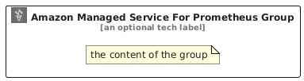

# AmazonManagedServiceForPrometheus


```text
aws/Architecture/ManagementTools/AmazonManagedServiceForPrometheus
```

```text
include('aws/Architecture/ManagementTools/AmazonManagedServiceForPrometheus')
```


| Illustration | AmazonManagedServiceForPrometheus | AmazonManagedServiceForPrometheusCard | AmazonManagedServiceForPrometheusGroup |
| :---: | :---: | :---: | :---: |
|  |  |  |  |


## Sprites
The item provides the following sriptes:

- `<$AmazonManagedServiceForPrometheusXs>`
- `<$AmazonManagedServiceForPrometheusSm>`
- `<$AmazonManagedServiceForPrometheusMd>`
- `<$AmazonManagedServiceForPrometheusLg>`


## AmazonManagedServiceForPrometheus

### Load remotely
```plantuml
@startuml
' configures the library
!global $LIB_BASE_LOCATION="https://raw.githubusercontent.com/tmorin/plantuml-libs/master/distribution"

' loads the library's bootstrap
!include $LIB_BASE_LOCATION/bootstrap.puml

' loads the package bootstrap
include('aws/bootstrap')

' loads the Item which embeds the element AmazonManagedServiceForPrometheus
include('aws/Architecture/ManagementTools/AmazonManagedServiceForPrometheus')

' renders the element
AmazonManagedServiceForPrometheus('AmazonManagedServiceForPrometheus', 'Amazon Managed Service For Prometheus', 'an optional tech label', 'an optional description')
@enduml
```

### Load locally
```plantuml
@startuml
' configures the library
!global $INCLUSION_MODE="local"
!global $LIB_BASE_LOCATION="../../.."

' loads the library's bootstrap
!include $LIB_BASE_LOCATION/bootstrap.puml

' loads the package bootstrap
include('aws/bootstrap')

' loads the Item which embeds the element AmazonManagedServiceForPrometheus
include('aws/Architecture/ManagementTools/AmazonManagedServiceForPrometheus')

' renders the element
AmazonManagedServiceForPrometheus('AmazonManagedServiceForPrometheus', 'Amazon Managed Service For Prometheus', 'an optional tech label', 'an optional description')
@enduml
```

## AmazonManagedServiceForPrometheusCard

### Load remotely
```plantuml
@startuml
' configures the library
!global $LIB_BASE_LOCATION="https://raw.githubusercontent.com/tmorin/plantuml-libs/master/distribution"

' loads the library's bootstrap
!include $LIB_BASE_LOCATION/bootstrap.puml

' loads the package bootstrap
include('aws/bootstrap')

' loads the Item which embeds the element AmazonManagedServiceForPrometheusCard
include('aws/Architecture/ManagementTools/AmazonManagedServiceForPrometheus')

' renders the element
AmazonManagedServiceForPrometheusCard('AmazonManagedServiceForPrometheusCard', 'Amazon Managed Service For Prometheus Card', 'an optional description')
@enduml
```

### Load locally
```plantuml
@startuml
' configures the library
!global $INCLUSION_MODE="local"
!global $LIB_BASE_LOCATION="../../.."

' loads the library's bootstrap
!include $LIB_BASE_LOCATION/bootstrap.puml

' loads the package bootstrap
include('aws/bootstrap')

' loads the Item which embeds the element AmazonManagedServiceForPrometheusCard
include('aws/Architecture/ManagementTools/AmazonManagedServiceForPrometheus')

' renders the element
AmazonManagedServiceForPrometheusCard('AmazonManagedServiceForPrometheusCard', 'Amazon Managed Service For Prometheus Card', 'an optional description')
@enduml
```

## AmazonManagedServiceForPrometheusGroup

### Load remotely
```plantuml
@startuml
' configures the library
!global $LIB_BASE_LOCATION="https://raw.githubusercontent.com/tmorin/plantuml-libs/master/distribution"

' loads the library's bootstrap
!include $LIB_BASE_LOCATION/bootstrap.puml

' loads the package bootstrap
include('aws/bootstrap')

' loads the Item which embeds the element AmazonManagedServiceForPrometheusGroup
include('aws/Architecture/ManagementTools/AmazonManagedServiceForPrometheus')

' renders the element
AmazonManagedServiceForPrometheusGroup('AmazonManagedServiceForPrometheusGroup', 'Amazon Managed Service For Prometheus Group', 'an optional tech label') {
    note as note
        the content of the group
    end note
}
@enduml
```

### Load locally
```plantuml
@startuml
' configures the library
!global $INCLUSION_MODE="local"
!global $LIB_BASE_LOCATION="../../.."

' loads the library's bootstrap
!include $LIB_BASE_LOCATION/bootstrap.puml

' loads the package bootstrap
include('aws/bootstrap')

' loads the Item which embeds the element AmazonManagedServiceForPrometheusGroup
include('aws/Architecture/ManagementTools/AmazonManagedServiceForPrometheus')

' renders the element
AmazonManagedServiceForPrometheusGroup('AmazonManagedServiceForPrometheusGroup', 'Amazon Managed Service For Prometheus Group', 'an optional tech label') {
    note as note
        the content of the group
    end note
}
@enduml
```

