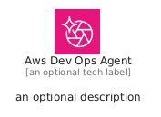
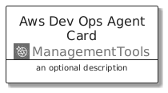
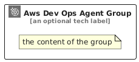

# AwsDevOpsAgent


```text
aws/Architecture/ManagementTools/AwsDevOpsAgent
```

```text
include('aws/Architecture/ManagementTools/AwsDevOpsAgent')
```


| Illustration | AwsDevOpsAgent | AwsDevOpsAgentCard | AwsDevOpsAgentGroup |
| :---: | :---: | :---: | :---: |
|  |  |  |  |


## Sprites
The item provides the following sriptes:

- `<$AwsDevOpsAgentXs>`
- `<$AwsDevOpsAgentSm>`
- `<$AwsDevOpsAgentMd>`
- `<$AwsDevOpsAgentLg>`


## AwsDevOpsAgent

### Load remotely
```plantuml
@startuml
' configures the library
!global $LIB_BASE_LOCATION="https://raw.githubusercontent.com/tmorin/plantuml-libs/master/distribution"

' loads the library's bootstrap
!include $LIB_BASE_LOCATION/bootstrap.puml

' loads the package bootstrap
include('aws/bootstrap')

' loads the Item which embeds the element AwsDevOpsAgent
include('aws/Architecture/ManagementTools/AwsDevOpsAgent')

' renders the element
AwsDevOpsAgent('AwsDevOpsAgent', 'Aws Dev Ops Agent', 'an optional tech label', 'an optional description')
@enduml
```

### Load locally
```plantuml
@startuml
' configures the library
!global $INCLUSION_MODE="local"
!global $LIB_BASE_LOCATION="../../.."

' loads the library's bootstrap
!include $LIB_BASE_LOCATION/bootstrap.puml

' loads the package bootstrap
include('aws/bootstrap')

' loads the Item which embeds the element AwsDevOpsAgent
include('aws/Architecture/ManagementTools/AwsDevOpsAgent')

' renders the element
AwsDevOpsAgent('AwsDevOpsAgent', 'Aws Dev Ops Agent', 'an optional tech label', 'an optional description')
@enduml
```

## AwsDevOpsAgentCard

### Load remotely
```plantuml
@startuml
' configures the library
!global $LIB_BASE_LOCATION="https://raw.githubusercontent.com/tmorin/plantuml-libs/master/distribution"

' loads the library's bootstrap
!include $LIB_BASE_LOCATION/bootstrap.puml

' loads the package bootstrap
include('aws/bootstrap')

' loads the Item which embeds the element AwsDevOpsAgentCard
include('aws/Architecture/ManagementTools/AwsDevOpsAgent')

' renders the element
AwsDevOpsAgentCard('AwsDevOpsAgentCard', 'Aws Dev Ops Agent Card', 'an optional description')
@enduml
```

### Load locally
```plantuml
@startuml
' configures the library
!global $INCLUSION_MODE="local"
!global $LIB_BASE_LOCATION="../../.."

' loads the library's bootstrap
!include $LIB_BASE_LOCATION/bootstrap.puml

' loads the package bootstrap
include('aws/bootstrap')

' loads the Item which embeds the element AwsDevOpsAgentCard
include('aws/Architecture/ManagementTools/AwsDevOpsAgent')

' renders the element
AwsDevOpsAgentCard('AwsDevOpsAgentCard', 'Aws Dev Ops Agent Card', 'an optional description')
@enduml
```

## AwsDevOpsAgentGroup

### Load remotely
```plantuml
@startuml
' configures the library
!global $LIB_BASE_LOCATION="https://raw.githubusercontent.com/tmorin/plantuml-libs/master/distribution"

' loads the library's bootstrap
!include $LIB_BASE_LOCATION/bootstrap.puml

' loads the package bootstrap
include('aws/bootstrap')

' loads the Item which embeds the element AwsDevOpsAgentGroup
include('aws/Architecture/ManagementTools/AwsDevOpsAgent')

' renders the element
AwsDevOpsAgentGroup('AwsDevOpsAgentGroup', 'Aws Dev Ops Agent Group', 'an optional tech label') {
    note as note
        the content of the group
    end note
}
@enduml
```

### Load locally
```plantuml
@startuml
' configures the library
!global $INCLUSION_MODE="local"
!global $LIB_BASE_LOCATION="../../.."

' loads the library's bootstrap
!include $LIB_BASE_LOCATION/bootstrap.puml

' loads the package bootstrap
include('aws/bootstrap')

' loads the Item which embeds the element AwsDevOpsAgentGroup
include('aws/Architecture/ManagementTools/AwsDevOpsAgent')

' renders the element
AwsDevOpsAgentGroup('AwsDevOpsAgentGroup', 'Aws Dev Ops Agent Group', 'an optional tech label') {
    note as note
        the content of the group
    end note
}
@enduml
```

