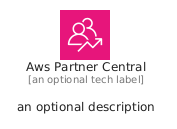
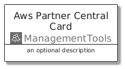
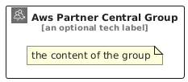

# AwsPartnerCentral


```text
aws/Architecture/ManagementTools/AwsPartnerCentral
```

```text
include('aws/Architecture/ManagementTools/AwsPartnerCentral')
```


| Illustration | AwsPartnerCentral | AwsPartnerCentralCard | AwsPartnerCentralGroup |
| :---: | :---: | :---: | :---: |
|  |  |  |  |


## Sprites
The item provides the following sriptes:

- `<$AwsPartnerCentralXs>`
- `<$AwsPartnerCentralSm>`
- `<$AwsPartnerCentralMd>`
- `<$AwsPartnerCentralLg>`


## AwsPartnerCentral

### Load remotely
```plantuml
@startuml
' configures the library
!global $LIB_BASE_LOCATION="https://raw.githubusercontent.com/tmorin/plantuml-libs/master/distribution"

' loads the library's bootstrap
!include $LIB_BASE_LOCATION/bootstrap.puml

' loads the package bootstrap
include('aws/bootstrap')

' loads the Item which embeds the element AwsPartnerCentral
include('aws/Architecture/ManagementTools/AwsPartnerCentral')

' renders the element
AwsPartnerCentral('AwsPartnerCentral', 'Aws Partner Central', 'an optional tech label', 'an optional description')
@enduml
```

### Load locally
```plantuml
@startuml
' configures the library
!global $INCLUSION_MODE="local"
!global $LIB_BASE_LOCATION="../../.."

' loads the library's bootstrap
!include $LIB_BASE_LOCATION/bootstrap.puml

' loads the package bootstrap
include('aws/bootstrap')

' loads the Item which embeds the element AwsPartnerCentral
include('aws/Architecture/ManagementTools/AwsPartnerCentral')

' renders the element
AwsPartnerCentral('AwsPartnerCentral', 'Aws Partner Central', 'an optional tech label', 'an optional description')
@enduml
```

## AwsPartnerCentralCard

### Load remotely
```plantuml
@startuml
' configures the library
!global $LIB_BASE_LOCATION="https://raw.githubusercontent.com/tmorin/plantuml-libs/master/distribution"

' loads the library's bootstrap
!include $LIB_BASE_LOCATION/bootstrap.puml

' loads the package bootstrap
include('aws/bootstrap')

' loads the Item which embeds the element AwsPartnerCentralCard
include('aws/Architecture/ManagementTools/AwsPartnerCentral')

' renders the element
AwsPartnerCentralCard('AwsPartnerCentralCard', 'Aws Partner Central Card', 'an optional description')
@enduml
```

### Load locally
```plantuml
@startuml
' configures the library
!global $INCLUSION_MODE="local"
!global $LIB_BASE_LOCATION="../../.."

' loads the library's bootstrap
!include $LIB_BASE_LOCATION/bootstrap.puml

' loads the package bootstrap
include('aws/bootstrap')

' loads the Item which embeds the element AwsPartnerCentralCard
include('aws/Architecture/ManagementTools/AwsPartnerCentral')

' renders the element
AwsPartnerCentralCard('AwsPartnerCentralCard', 'Aws Partner Central Card', 'an optional description')
@enduml
```

## AwsPartnerCentralGroup

### Load remotely
```plantuml
@startuml
' configures the library
!global $LIB_BASE_LOCATION="https://raw.githubusercontent.com/tmorin/plantuml-libs/master/distribution"

' loads the library's bootstrap
!include $LIB_BASE_LOCATION/bootstrap.puml

' loads the package bootstrap
include('aws/bootstrap')

' loads the Item which embeds the element AwsPartnerCentralGroup
include('aws/Architecture/ManagementTools/AwsPartnerCentral')

' renders the element
AwsPartnerCentralGroup('AwsPartnerCentralGroup', 'Aws Partner Central Group', 'an optional tech label') {
    note as note
        the content of the group
    end note
}
@enduml
```

### Load locally
```plantuml
@startuml
' configures the library
!global $INCLUSION_MODE="local"
!global $LIB_BASE_LOCATION="../../.."

' loads the library's bootstrap
!include $LIB_BASE_LOCATION/bootstrap.puml

' loads the package bootstrap
include('aws/bootstrap')

' loads the Item which embeds the element AwsPartnerCentralGroup
include('aws/Architecture/ManagementTools/AwsPartnerCentral')

' renders the element
AwsPartnerCentralGroup('AwsPartnerCentralGroup', 'Aws Partner Central Group', 'an optional tech label') {
    note as note
        the content of the group
    end note
}
@enduml
```

