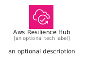
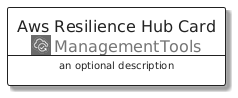
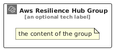

# AwsResilienceHub


```text
aws/Architecture/ManagementTools/AwsResilienceHub
```

```text
include('aws/Architecture/ManagementTools/AwsResilienceHub')
```


| Illustration | AwsResilienceHub | AwsResilienceHubCard | AwsResilienceHubGroup |
| :---: | :---: | :---: | :---: |
|  |  |  |  |


## Sprites
The item provides the following sriptes:

- `<$AwsResilienceHubXs>`
- `<$AwsResilienceHubSm>`
- `<$AwsResilienceHubMd>`
- `<$AwsResilienceHubLg>`


## AwsResilienceHub

### Load remotely
```plantuml
@startuml
' configures the library
!global $LIB_BASE_LOCATION="https://raw.githubusercontent.com/tmorin/plantuml-libs/master/distribution"

' loads the library's bootstrap
!include $LIB_BASE_LOCATION/bootstrap.puml

' loads the package bootstrap
include('aws/bootstrap')

' loads the Item which embeds the element AwsResilienceHub
include('aws/Architecture/ManagementTools/AwsResilienceHub')

' renders the element
AwsResilienceHub('AwsResilienceHub', 'Aws Resilience Hub', 'an optional tech label', 'an optional description')
@enduml
```

### Load locally
```plantuml
@startuml
' configures the library
!global $INCLUSION_MODE="local"
!global $LIB_BASE_LOCATION="../../.."

' loads the library's bootstrap
!include $LIB_BASE_LOCATION/bootstrap.puml

' loads the package bootstrap
include('aws/bootstrap')

' loads the Item which embeds the element AwsResilienceHub
include('aws/Architecture/ManagementTools/AwsResilienceHub')

' renders the element
AwsResilienceHub('AwsResilienceHub', 'Aws Resilience Hub', 'an optional tech label', 'an optional description')
@enduml
```

## AwsResilienceHubCard

### Load remotely
```plantuml
@startuml
' configures the library
!global $LIB_BASE_LOCATION="https://raw.githubusercontent.com/tmorin/plantuml-libs/master/distribution"

' loads the library's bootstrap
!include $LIB_BASE_LOCATION/bootstrap.puml

' loads the package bootstrap
include('aws/bootstrap')

' loads the Item which embeds the element AwsResilienceHubCard
include('aws/Architecture/ManagementTools/AwsResilienceHub')

' renders the element
AwsResilienceHubCard('AwsResilienceHubCard', 'Aws Resilience Hub Card', 'an optional description')
@enduml
```

### Load locally
```plantuml
@startuml
' configures the library
!global $INCLUSION_MODE="local"
!global $LIB_BASE_LOCATION="../../.."

' loads the library's bootstrap
!include $LIB_BASE_LOCATION/bootstrap.puml

' loads the package bootstrap
include('aws/bootstrap')

' loads the Item which embeds the element AwsResilienceHubCard
include('aws/Architecture/ManagementTools/AwsResilienceHub')

' renders the element
AwsResilienceHubCard('AwsResilienceHubCard', 'Aws Resilience Hub Card', 'an optional description')
@enduml
```

## AwsResilienceHubGroup

### Load remotely
```plantuml
@startuml
' configures the library
!global $LIB_BASE_LOCATION="https://raw.githubusercontent.com/tmorin/plantuml-libs/master/distribution"

' loads the library's bootstrap
!include $LIB_BASE_LOCATION/bootstrap.puml

' loads the package bootstrap
include('aws/bootstrap')

' loads the Item which embeds the element AwsResilienceHubGroup
include('aws/Architecture/ManagementTools/AwsResilienceHub')

' renders the element
AwsResilienceHubGroup('AwsResilienceHubGroup', 'Aws Resilience Hub Group', 'an optional tech label') {
    note as note
        the content of the group
    end note
}
@enduml
```

### Load locally
```plantuml
@startuml
' configures the library
!global $INCLUSION_MODE="local"
!global $LIB_BASE_LOCATION="../../.."

' loads the library's bootstrap
!include $LIB_BASE_LOCATION/bootstrap.puml

' loads the package bootstrap
include('aws/bootstrap')

' loads the Item which embeds the element AwsResilienceHubGroup
include('aws/Architecture/ManagementTools/AwsResilienceHub')

' renders the element
AwsResilienceHubGroup('AwsResilienceHubGroup', 'Aws Resilience Hub Group', 'an optional tech label') {
    note as note
        the content of the group
    end note
}
@enduml
```

