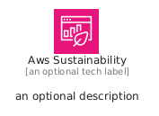
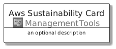
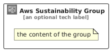

# AwsSustainability


```text
aws/Architecture/ManagementTools/AwsSustainability
```

```text
include('aws/Architecture/ManagementTools/AwsSustainability')
```


| Illustration | AwsSustainability | AwsSustainabilityCard | AwsSustainabilityGroup |
| :---: | :---: | :---: | :---: |
|  |  |  |  |


## Sprites
The item provides the following sriptes:

- `<$AwsSustainabilityXs>`
- `<$AwsSustainabilitySm>`
- `<$AwsSustainabilityMd>`
- `<$AwsSustainabilityLg>`


## AwsSustainability

### Load remotely
```plantuml
@startuml
' configures the library
!global $LIB_BASE_LOCATION="https://raw.githubusercontent.com/tmorin/plantuml-libs/master/distribution"

' loads the library's bootstrap
!include $LIB_BASE_LOCATION/bootstrap.puml

' loads the package bootstrap
include('aws/bootstrap')

' loads the Item which embeds the element AwsSustainability
include('aws/Architecture/ManagementTools/AwsSustainability')

' renders the element
AwsSustainability('AwsSustainability', 'Aws Sustainability', 'an optional tech label', 'an optional description')
@enduml
```

### Load locally
```plantuml
@startuml
' configures the library
!global $INCLUSION_MODE="local"
!global $LIB_BASE_LOCATION="../../.."

' loads the library's bootstrap
!include $LIB_BASE_LOCATION/bootstrap.puml

' loads the package bootstrap
include('aws/bootstrap')

' loads the Item which embeds the element AwsSustainability
include('aws/Architecture/ManagementTools/AwsSustainability')

' renders the element
AwsSustainability('AwsSustainability', 'Aws Sustainability', 'an optional tech label', 'an optional description')
@enduml
```

## AwsSustainabilityCard

### Load remotely
```plantuml
@startuml
' configures the library
!global $LIB_BASE_LOCATION="https://raw.githubusercontent.com/tmorin/plantuml-libs/master/distribution"

' loads the library's bootstrap
!include $LIB_BASE_LOCATION/bootstrap.puml

' loads the package bootstrap
include('aws/bootstrap')

' loads the Item which embeds the element AwsSustainabilityCard
include('aws/Architecture/ManagementTools/AwsSustainability')

' renders the element
AwsSustainabilityCard('AwsSustainabilityCard', 'Aws Sustainability Card', 'an optional description')
@enduml
```

### Load locally
```plantuml
@startuml
' configures the library
!global $INCLUSION_MODE="local"
!global $LIB_BASE_LOCATION="../../.."

' loads the library's bootstrap
!include $LIB_BASE_LOCATION/bootstrap.puml

' loads the package bootstrap
include('aws/bootstrap')

' loads the Item which embeds the element AwsSustainabilityCard
include('aws/Architecture/ManagementTools/AwsSustainability')

' renders the element
AwsSustainabilityCard('AwsSustainabilityCard', 'Aws Sustainability Card', 'an optional description')
@enduml
```

## AwsSustainabilityGroup

### Load remotely
```plantuml
@startuml
' configures the library
!global $LIB_BASE_LOCATION="https://raw.githubusercontent.com/tmorin/plantuml-libs/master/distribution"

' loads the library's bootstrap
!include $LIB_BASE_LOCATION/bootstrap.puml

' loads the package bootstrap
include('aws/bootstrap')

' loads the Item which embeds the element AwsSustainabilityGroup
include('aws/Architecture/ManagementTools/AwsSustainability')

' renders the element
AwsSustainabilityGroup('AwsSustainabilityGroup', 'Aws Sustainability Group', 'an optional tech label') {
    note as note
        the content of the group
    end note
}
@enduml
```

### Load locally
```plantuml
@startuml
' configures the library
!global $INCLUSION_MODE="local"
!global $LIB_BASE_LOCATION="../../.."

' loads the library's bootstrap
!include $LIB_BASE_LOCATION/bootstrap.puml

' loads the package bootstrap
include('aws/bootstrap')

' loads the Item which embeds the element AwsSustainabilityGroup
include('aws/Architecture/ManagementTools/AwsSustainability')

' renders the element
AwsSustainabilityGroup('AwsSustainabilityGroup', 'Aws Sustainability Group', 'an optional tech label') {
    note as note
        the content of the group
    end note
}
@enduml
```

