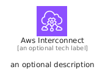
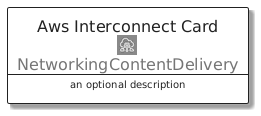
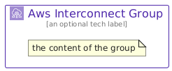

# AwsInterconnect


```text
aws/Architecture/NetworkingContentDelivery/AwsInterconnect
```

```text
include('aws/Architecture/NetworkingContentDelivery/AwsInterconnect')
```


| Illustration | AwsInterconnect | AwsInterconnectCard | AwsInterconnectGroup |
| :---: | :---: | :---: | :---: |
|  |  |  |  |


## Sprites
The item provides the following sriptes:

- `<$AwsInterconnectXs>`
- `<$AwsInterconnectSm>`
- `<$AwsInterconnectMd>`
- `<$AwsInterconnectLg>`


## AwsInterconnect

### Load remotely
```plantuml
@startuml
' configures the library
!global $LIB_BASE_LOCATION="https://raw.githubusercontent.com/tmorin/plantuml-libs/master/distribution"

' loads the library's bootstrap
!include $LIB_BASE_LOCATION/bootstrap.puml

' loads the package bootstrap
include('aws/bootstrap')

' loads the Item which embeds the element AwsInterconnect
include('aws/Architecture/NetworkingContentDelivery/AwsInterconnect')

' renders the element
AwsInterconnect('AwsInterconnect', 'Aws Interconnect', 'an optional tech label', 'an optional description')
@enduml
```

### Load locally
```plantuml
@startuml
' configures the library
!global $INCLUSION_MODE="local"
!global $LIB_BASE_LOCATION="../../.."

' loads the library's bootstrap
!include $LIB_BASE_LOCATION/bootstrap.puml

' loads the package bootstrap
include('aws/bootstrap')

' loads the Item which embeds the element AwsInterconnect
include('aws/Architecture/NetworkingContentDelivery/AwsInterconnect')

' renders the element
AwsInterconnect('AwsInterconnect', 'Aws Interconnect', 'an optional tech label', 'an optional description')
@enduml
```

## AwsInterconnectCard

### Load remotely
```plantuml
@startuml
' configures the library
!global $LIB_BASE_LOCATION="https://raw.githubusercontent.com/tmorin/plantuml-libs/master/distribution"

' loads the library's bootstrap
!include $LIB_BASE_LOCATION/bootstrap.puml

' loads the package bootstrap
include('aws/bootstrap')

' loads the Item which embeds the element AwsInterconnectCard
include('aws/Architecture/NetworkingContentDelivery/AwsInterconnect')

' renders the element
AwsInterconnectCard('AwsInterconnectCard', 'Aws Interconnect Card', 'an optional description')
@enduml
```

### Load locally
```plantuml
@startuml
' configures the library
!global $INCLUSION_MODE="local"
!global $LIB_BASE_LOCATION="../../.."

' loads the library's bootstrap
!include $LIB_BASE_LOCATION/bootstrap.puml

' loads the package bootstrap
include('aws/bootstrap')

' loads the Item which embeds the element AwsInterconnectCard
include('aws/Architecture/NetworkingContentDelivery/AwsInterconnect')

' renders the element
AwsInterconnectCard('AwsInterconnectCard', 'Aws Interconnect Card', 'an optional description')
@enduml
```

## AwsInterconnectGroup

### Load remotely
```plantuml
@startuml
' configures the library
!global $LIB_BASE_LOCATION="https://raw.githubusercontent.com/tmorin/plantuml-libs/master/distribution"

' loads the library's bootstrap
!include $LIB_BASE_LOCATION/bootstrap.puml

' loads the package bootstrap
include('aws/bootstrap')

' loads the Item which embeds the element AwsInterconnectGroup
include('aws/Architecture/NetworkingContentDelivery/AwsInterconnect')

' renders the element
AwsInterconnectGroup('AwsInterconnectGroup', 'Aws Interconnect Group', 'an optional tech label') {
    note as note
        the content of the group
    end note
}
@enduml
```

### Load locally
```plantuml
@startuml
' configures the library
!global $INCLUSION_MODE="local"
!global $LIB_BASE_LOCATION="../../.."

' loads the library's bootstrap
!include $LIB_BASE_LOCATION/bootstrap.puml

' loads the package bootstrap
include('aws/bootstrap')

' loads the Item which embeds the element AwsInterconnectGroup
include('aws/Architecture/NetworkingContentDelivery/AwsInterconnect')

' renders the element
AwsInterconnectGroup('AwsInterconnectGroup', 'Aws Interconnect Group', 'an optional tech label') {
    note as note
        the content of the group
    end note
}
@enduml
```

