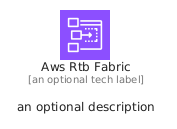
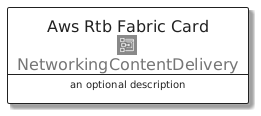
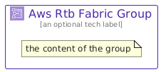

# AwsRtbFabric


```text
aws/Architecture/NetworkingContentDelivery/AwsRtbFabric
```

```text
include('aws/Architecture/NetworkingContentDelivery/AwsRtbFabric')
```


| Illustration | AwsRtbFabric | AwsRtbFabricCard | AwsRtbFabricGroup |
| :---: | :---: | :---: | :---: |
|  |  |  |  |


## Sprites
The item provides the following sriptes:

- `<$AwsRtbFabricXs>`
- `<$AwsRtbFabricSm>`
- `<$AwsRtbFabricMd>`
- `<$AwsRtbFabricLg>`


## AwsRtbFabric

### Load remotely
```plantuml
@startuml
' configures the library
!global $LIB_BASE_LOCATION="https://raw.githubusercontent.com/tmorin/plantuml-libs/master/distribution"

' loads the library's bootstrap
!include $LIB_BASE_LOCATION/bootstrap.puml

' loads the package bootstrap
include('aws/bootstrap')

' loads the Item which embeds the element AwsRtbFabric
include('aws/Architecture/NetworkingContentDelivery/AwsRtbFabric')

' renders the element
AwsRtbFabric('AwsRtbFabric', 'Aws Rtb Fabric', 'an optional tech label', 'an optional description')
@enduml
```

### Load locally
```plantuml
@startuml
' configures the library
!global $INCLUSION_MODE="local"
!global $LIB_BASE_LOCATION="../../.."

' loads the library's bootstrap
!include $LIB_BASE_LOCATION/bootstrap.puml

' loads the package bootstrap
include('aws/bootstrap')

' loads the Item which embeds the element AwsRtbFabric
include('aws/Architecture/NetworkingContentDelivery/AwsRtbFabric')

' renders the element
AwsRtbFabric('AwsRtbFabric', 'Aws Rtb Fabric', 'an optional tech label', 'an optional description')
@enduml
```

## AwsRtbFabricCard

### Load remotely
```plantuml
@startuml
' configures the library
!global $LIB_BASE_LOCATION="https://raw.githubusercontent.com/tmorin/plantuml-libs/master/distribution"

' loads the library's bootstrap
!include $LIB_BASE_LOCATION/bootstrap.puml

' loads the package bootstrap
include('aws/bootstrap')

' loads the Item which embeds the element AwsRtbFabricCard
include('aws/Architecture/NetworkingContentDelivery/AwsRtbFabric')

' renders the element
AwsRtbFabricCard('AwsRtbFabricCard', 'Aws Rtb Fabric Card', 'an optional description')
@enduml
```

### Load locally
```plantuml
@startuml
' configures the library
!global $INCLUSION_MODE="local"
!global $LIB_BASE_LOCATION="../../.."

' loads the library's bootstrap
!include $LIB_BASE_LOCATION/bootstrap.puml

' loads the package bootstrap
include('aws/bootstrap')

' loads the Item which embeds the element AwsRtbFabricCard
include('aws/Architecture/NetworkingContentDelivery/AwsRtbFabric')

' renders the element
AwsRtbFabricCard('AwsRtbFabricCard', 'Aws Rtb Fabric Card', 'an optional description')
@enduml
```

## AwsRtbFabricGroup

### Load remotely
```plantuml
@startuml
' configures the library
!global $LIB_BASE_LOCATION="https://raw.githubusercontent.com/tmorin/plantuml-libs/master/distribution"

' loads the library's bootstrap
!include $LIB_BASE_LOCATION/bootstrap.puml

' loads the package bootstrap
include('aws/bootstrap')

' loads the Item which embeds the element AwsRtbFabricGroup
include('aws/Architecture/NetworkingContentDelivery/AwsRtbFabric')

' renders the element
AwsRtbFabricGroup('AwsRtbFabricGroup', 'Aws Rtb Fabric Group', 'an optional tech label') {
    note as note
        the content of the group
    end note
}
@enduml
```

### Load locally
```plantuml
@startuml
' configures the library
!global $INCLUSION_MODE="local"
!global $LIB_BASE_LOCATION="../../.."

' loads the library's bootstrap
!include $LIB_BASE_LOCATION/bootstrap.puml

' loads the package bootstrap
include('aws/bootstrap')

' loads the Item which embeds the element AwsRtbFabricGroup
include('aws/Architecture/NetworkingContentDelivery/AwsRtbFabric')

' renders the element
AwsRtbFabricGroup('AwsRtbFabricGroup', 'Aws Rtb Fabric Group', 'an optional tech label') {
    note as note
        the content of the group
    end note
}
@enduml
```

