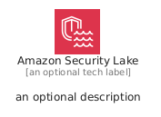
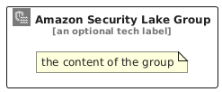

# AmazonSecurityLake


```text
aws/Architecture/SecurityIdentity/AmazonSecurityLake
```

```text
include('aws/Architecture/SecurityIdentity/AmazonSecurityLake')
```


| Illustration | AmazonSecurityLake | AmazonSecurityLakeCard | AmazonSecurityLakeGroup |
| :---: | :---: | :---: | :---: |
|  |  |  |  |


## Sprites
The item provides the following sriptes:

- `<$AmazonSecurityLakeXs>`
- `<$AmazonSecurityLakeSm>`
- `<$AmazonSecurityLakeMd>`
- `<$AmazonSecurityLakeLg>`


## AmazonSecurityLake

### Load remotely
```plantuml
@startuml
' configures the library
!global $LIB_BASE_LOCATION="https://raw.githubusercontent.com/tmorin/plantuml-libs/master/distribution"

' loads the library's bootstrap
!include $LIB_BASE_LOCATION/bootstrap.puml

' loads the package bootstrap
include('aws/bootstrap')

' loads the Item which embeds the element AmazonSecurityLake
include('aws/Architecture/SecurityIdentity/AmazonSecurityLake')

' renders the element
AmazonSecurityLake('AmazonSecurityLake', 'Amazon Security Lake', 'an optional tech label', 'an optional description')
@enduml
```

### Load locally
```plantuml
@startuml
' configures the library
!global $INCLUSION_MODE="local"
!global $LIB_BASE_LOCATION="../../.."

' loads the library's bootstrap
!include $LIB_BASE_LOCATION/bootstrap.puml

' loads the package bootstrap
include('aws/bootstrap')

' loads the Item which embeds the element AmazonSecurityLake
include('aws/Architecture/SecurityIdentity/AmazonSecurityLake')

' renders the element
AmazonSecurityLake('AmazonSecurityLake', 'Amazon Security Lake', 'an optional tech label', 'an optional description')
@enduml
```

## AmazonSecurityLakeCard

### Load remotely
```plantuml
@startuml
' configures the library
!global $LIB_BASE_LOCATION="https://raw.githubusercontent.com/tmorin/plantuml-libs/master/distribution"

' loads the library's bootstrap
!include $LIB_BASE_LOCATION/bootstrap.puml

' loads the package bootstrap
include('aws/bootstrap')

' loads the Item which embeds the element AmazonSecurityLakeCard
include('aws/Architecture/SecurityIdentity/AmazonSecurityLake')

' renders the element
AmazonSecurityLakeCard('AmazonSecurityLakeCard', 'Amazon Security Lake Card', 'an optional description')
@enduml
```

### Load locally
```plantuml
@startuml
' configures the library
!global $INCLUSION_MODE="local"
!global $LIB_BASE_LOCATION="../../.."

' loads the library's bootstrap
!include $LIB_BASE_LOCATION/bootstrap.puml

' loads the package bootstrap
include('aws/bootstrap')

' loads the Item which embeds the element AmazonSecurityLakeCard
include('aws/Architecture/SecurityIdentity/AmazonSecurityLake')

' renders the element
AmazonSecurityLakeCard('AmazonSecurityLakeCard', 'Amazon Security Lake Card', 'an optional description')
@enduml
```

## AmazonSecurityLakeGroup

### Load remotely
```plantuml
@startuml
' configures the library
!global $LIB_BASE_LOCATION="https://raw.githubusercontent.com/tmorin/plantuml-libs/master/distribution"

' loads the library's bootstrap
!include $LIB_BASE_LOCATION/bootstrap.puml

' loads the package bootstrap
include('aws/bootstrap')

' loads the Item which embeds the element AmazonSecurityLakeGroup
include('aws/Architecture/SecurityIdentity/AmazonSecurityLake')

' renders the element
AmazonSecurityLakeGroup('AmazonSecurityLakeGroup', 'Amazon Security Lake Group', 'an optional tech label') {
    note as note
        the content of the group
    end note
}
@enduml
```

### Load locally
```plantuml
@startuml
' configures the library
!global $INCLUSION_MODE="local"
!global $LIB_BASE_LOCATION="../../.."

' loads the library's bootstrap
!include $LIB_BASE_LOCATION/bootstrap.puml

' loads the package bootstrap
include('aws/bootstrap')

' loads the Item which embeds the element AmazonSecurityLakeGroup
include('aws/Architecture/SecurityIdentity/AmazonSecurityLake')

' renders the element
AmazonSecurityLakeGroup('AmazonSecurityLakeGroup', 'Amazon Security Lake Group', 'an optional tech label') {
    note as note
        the content of the group
    end note
}
@enduml
```

