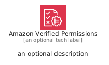
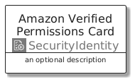
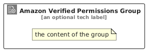

# AmazonVerifiedPermissions


```text
aws/Architecture/SecurityIdentity/AmazonVerifiedPermissions
```

```text
include('aws/Architecture/SecurityIdentity/AmazonVerifiedPermissions')
```


| Illustration | AmazonVerifiedPermissions | AmazonVerifiedPermissionsCard | AmazonVerifiedPermissionsGroup |
| :---: | :---: | :---: | :---: |
|  |  |  |  |


## Sprites
The item provides the following sriptes:

- `<$AmazonVerifiedPermissionsXs>`
- `<$AmazonVerifiedPermissionsSm>`
- `<$AmazonVerifiedPermissionsMd>`
- `<$AmazonVerifiedPermissionsLg>`


## AmazonVerifiedPermissions

### Load remotely
```plantuml
@startuml
' configures the library
!global $LIB_BASE_LOCATION="https://raw.githubusercontent.com/tmorin/plantuml-libs/master/distribution"

' loads the library's bootstrap
!include $LIB_BASE_LOCATION/bootstrap.puml

' loads the package bootstrap
include('aws/bootstrap')

' loads the Item which embeds the element AmazonVerifiedPermissions
include('aws/Architecture/SecurityIdentity/AmazonVerifiedPermissions')

' renders the element
AmazonVerifiedPermissions('AmazonVerifiedPermissions', 'Amazon Verified Permissions', 'an optional tech label', 'an optional description')
@enduml
```

### Load locally
```plantuml
@startuml
' configures the library
!global $INCLUSION_MODE="local"
!global $LIB_BASE_LOCATION="../../.."

' loads the library's bootstrap
!include $LIB_BASE_LOCATION/bootstrap.puml

' loads the package bootstrap
include('aws/bootstrap')

' loads the Item which embeds the element AmazonVerifiedPermissions
include('aws/Architecture/SecurityIdentity/AmazonVerifiedPermissions')

' renders the element
AmazonVerifiedPermissions('AmazonVerifiedPermissions', 'Amazon Verified Permissions', 'an optional tech label', 'an optional description')
@enduml
```

## AmazonVerifiedPermissionsCard

### Load remotely
```plantuml
@startuml
' configures the library
!global $LIB_BASE_LOCATION="https://raw.githubusercontent.com/tmorin/plantuml-libs/master/distribution"

' loads the library's bootstrap
!include $LIB_BASE_LOCATION/bootstrap.puml

' loads the package bootstrap
include('aws/bootstrap')

' loads the Item which embeds the element AmazonVerifiedPermissionsCard
include('aws/Architecture/SecurityIdentity/AmazonVerifiedPermissions')

' renders the element
AmazonVerifiedPermissionsCard('AmazonVerifiedPermissionsCard', 'Amazon Verified Permissions Card', 'an optional description')
@enduml
```

### Load locally
```plantuml
@startuml
' configures the library
!global $INCLUSION_MODE="local"
!global $LIB_BASE_LOCATION="../../.."

' loads the library's bootstrap
!include $LIB_BASE_LOCATION/bootstrap.puml

' loads the package bootstrap
include('aws/bootstrap')

' loads the Item which embeds the element AmazonVerifiedPermissionsCard
include('aws/Architecture/SecurityIdentity/AmazonVerifiedPermissions')

' renders the element
AmazonVerifiedPermissionsCard('AmazonVerifiedPermissionsCard', 'Amazon Verified Permissions Card', 'an optional description')
@enduml
```

## AmazonVerifiedPermissionsGroup

### Load remotely
```plantuml
@startuml
' configures the library
!global $LIB_BASE_LOCATION="https://raw.githubusercontent.com/tmorin/plantuml-libs/master/distribution"

' loads the library's bootstrap
!include $LIB_BASE_LOCATION/bootstrap.puml

' loads the package bootstrap
include('aws/bootstrap')

' loads the Item which embeds the element AmazonVerifiedPermissionsGroup
include('aws/Architecture/SecurityIdentity/AmazonVerifiedPermissions')

' renders the element
AmazonVerifiedPermissionsGroup('AmazonVerifiedPermissionsGroup', 'Amazon Verified Permissions Group', 'an optional tech label') {
    note as note
        the content of the group
    end note
}
@enduml
```

### Load locally
```plantuml
@startuml
' configures the library
!global $INCLUSION_MODE="local"
!global $LIB_BASE_LOCATION="../../.."

' loads the library's bootstrap
!include $LIB_BASE_LOCATION/bootstrap.puml

' loads the package bootstrap
include('aws/bootstrap')

' loads the Item which embeds the element AmazonVerifiedPermissionsGroup
include('aws/Architecture/SecurityIdentity/AmazonVerifiedPermissions')

' renders the element
AmazonVerifiedPermissionsGroup('AmazonVerifiedPermissionsGroup', 'Amazon Verified Permissions Group', 'an optional tech label') {
    note as note
        the content of the group
    end note
}
@enduml
```

