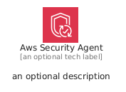
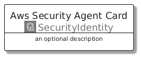
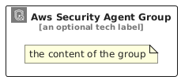

# AwsSecurityAgent


```text
aws/Architecture/SecurityIdentity/AwsSecurityAgent
```

```text
include('aws/Architecture/SecurityIdentity/AwsSecurityAgent')
```


| Illustration | AwsSecurityAgent | AwsSecurityAgentCard | AwsSecurityAgentGroup |
| :---: | :---: | :---: | :---: |
|  |  |  |  |


## Sprites
The item provides the following sriptes:

- `<$AwsSecurityAgentXs>`
- `<$AwsSecurityAgentSm>`
- `<$AwsSecurityAgentMd>`
- `<$AwsSecurityAgentLg>`


## AwsSecurityAgent

### Load remotely
```plantuml
@startuml
' configures the library
!global $LIB_BASE_LOCATION="https://raw.githubusercontent.com/tmorin/plantuml-libs/master/distribution"

' loads the library's bootstrap
!include $LIB_BASE_LOCATION/bootstrap.puml

' loads the package bootstrap
include('aws/bootstrap')

' loads the Item which embeds the element AwsSecurityAgent
include('aws/Architecture/SecurityIdentity/AwsSecurityAgent')

' renders the element
AwsSecurityAgent('AwsSecurityAgent', 'Aws Security Agent', 'an optional tech label', 'an optional description')
@enduml
```

### Load locally
```plantuml
@startuml
' configures the library
!global $INCLUSION_MODE="local"
!global $LIB_BASE_LOCATION="../../.."

' loads the library's bootstrap
!include $LIB_BASE_LOCATION/bootstrap.puml

' loads the package bootstrap
include('aws/bootstrap')

' loads the Item which embeds the element AwsSecurityAgent
include('aws/Architecture/SecurityIdentity/AwsSecurityAgent')

' renders the element
AwsSecurityAgent('AwsSecurityAgent', 'Aws Security Agent', 'an optional tech label', 'an optional description')
@enduml
```

## AwsSecurityAgentCard

### Load remotely
```plantuml
@startuml
' configures the library
!global $LIB_BASE_LOCATION="https://raw.githubusercontent.com/tmorin/plantuml-libs/master/distribution"

' loads the library's bootstrap
!include $LIB_BASE_LOCATION/bootstrap.puml

' loads the package bootstrap
include('aws/bootstrap')

' loads the Item which embeds the element AwsSecurityAgentCard
include('aws/Architecture/SecurityIdentity/AwsSecurityAgent')

' renders the element
AwsSecurityAgentCard('AwsSecurityAgentCard', 'Aws Security Agent Card', 'an optional description')
@enduml
```

### Load locally
```plantuml
@startuml
' configures the library
!global $INCLUSION_MODE="local"
!global $LIB_BASE_LOCATION="../../.."

' loads the library's bootstrap
!include $LIB_BASE_LOCATION/bootstrap.puml

' loads the package bootstrap
include('aws/bootstrap')

' loads the Item which embeds the element AwsSecurityAgentCard
include('aws/Architecture/SecurityIdentity/AwsSecurityAgent')

' renders the element
AwsSecurityAgentCard('AwsSecurityAgentCard', 'Aws Security Agent Card', 'an optional description')
@enduml
```

## AwsSecurityAgentGroup

### Load remotely
```plantuml
@startuml
' configures the library
!global $LIB_BASE_LOCATION="https://raw.githubusercontent.com/tmorin/plantuml-libs/master/distribution"

' loads the library's bootstrap
!include $LIB_BASE_LOCATION/bootstrap.puml

' loads the package bootstrap
include('aws/bootstrap')

' loads the Item which embeds the element AwsSecurityAgentGroup
include('aws/Architecture/SecurityIdentity/AwsSecurityAgent')

' renders the element
AwsSecurityAgentGroup('AwsSecurityAgentGroup', 'Aws Security Agent Group', 'an optional tech label') {
    note as note
        the content of the group
    end note
}
@enduml
```

### Load locally
```plantuml
@startuml
' configures the library
!global $INCLUSION_MODE="local"
!global $LIB_BASE_LOCATION="../../.."

' loads the library's bootstrap
!include $LIB_BASE_LOCATION/bootstrap.puml

' loads the package bootstrap
include('aws/bootstrap')

' loads the Item which embeds the element AwsSecurityAgentGroup
include('aws/Architecture/SecurityIdentity/AwsSecurityAgent')

' renders the element
AwsSecurityAgentGroup('AwsSecurityAgentGroup', 'Aws Security Agent Group', 'an optional tech label') {
    note as note
        the content of the group
    end note
}
@enduml
```

