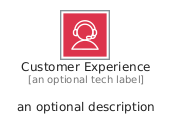
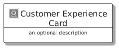
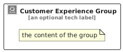

# CustomerExperience


```text
aws/Category/CustomerExperience
```

```text
include('aws/Category/CustomerExperience')
```


| Illustration | CustomerExperience | CustomerExperienceCard | CustomerExperienceGroup |
| :---: | :---: | :---: | :---: |
|  |  |  |  |


## Sprites
The item provides the following sriptes:

- `<$CustomerExperienceXs>`
- `<$CustomerExperienceSm>`
- `<$CustomerExperienceMd>`
- `<$CustomerExperienceLg>`


## CustomerExperience

### Load remotely
```plantuml
@startuml
' configures the library
!global $LIB_BASE_LOCATION="https://raw.githubusercontent.com/tmorin/plantuml-libs/master/distribution"

' loads the library's bootstrap
!include $LIB_BASE_LOCATION/bootstrap.puml

' loads the package bootstrap
include('aws/bootstrap')

' loads the Item which embeds the element CustomerExperience
include('aws/Category/CustomerExperience')

' renders the element
CustomerExperience('CustomerExperience', 'Customer Experience', 'an optional tech label', 'an optional description')
@enduml
```

### Load locally
```plantuml
@startuml
' configures the library
!global $INCLUSION_MODE="local"
!global $LIB_BASE_LOCATION="../.."

' loads the library's bootstrap
!include $LIB_BASE_LOCATION/bootstrap.puml

' loads the package bootstrap
include('aws/bootstrap')

' loads the Item which embeds the element CustomerExperience
include('aws/Category/CustomerExperience')

' renders the element
CustomerExperience('CustomerExperience', 'Customer Experience', 'an optional tech label', 'an optional description')
@enduml
```

## CustomerExperienceCard

### Load remotely
```plantuml
@startuml
' configures the library
!global $LIB_BASE_LOCATION="https://raw.githubusercontent.com/tmorin/plantuml-libs/master/distribution"

' loads the library's bootstrap
!include $LIB_BASE_LOCATION/bootstrap.puml

' loads the package bootstrap
include('aws/bootstrap')

' loads the Item which embeds the element CustomerExperienceCard
include('aws/Category/CustomerExperience')

' renders the element
CustomerExperienceCard('CustomerExperienceCard', 'Customer Experience Card', 'an optional description')
@enduml
```

### Load locally
```plantuml
@startuml
' configures the library
!global $INCLUSION_MODE="local"
!global $LIB_BASE_LOCATION="../.."

' loads the library's bootstrap
!include $LIB_BASE_LOCATION/bootstrap.puml

' loads the package bootstrap
include('aws/bootstrap')

' loads the Item which embeds the element CustomerExperienceCard
include('aws/Category/CustomerExperience')

' renders the element
CustomerExperienceCard('CustomerExperienceCard', 'Customer Experience Card', 'an optional description')
@enduml
```

## CustomerExperienceGroup

### Load remotely
```plantuml
@startuml
' configures the library
!global $LIB_BASE_LOCATION="https://raw.githubusercontent.com/tmorin/plantuml-libs/master/distribution"

' loads the library's bootstrap
!include $LIB_BASE_LOCATION/bootstrap.puml

' loads the package bootstrap
include('aws/bootstrap')

' loads the Item which embeds the element CustomerExperienceGroup
include('aws/Category/CustomerExperience')

' renders the element
CustomerExperienceGroup('CustomerExperienceGroup', 'Customer Experience Group', 'an optional tech label') {
    note as note
        the content of the group
    end note
}
@enduml
```

### Load locally
```plantuml
@startuml
' configures the library
!global $INCLUSION_MODE="local"
!global $LIB_BASE_LOCATION="../.."

' loads the library's bootstrap
!include $LIB_BASE_LOCATION/bootstrap.puml

' loads the package bootstrap
include('aws/bootstrap')

' loads the Item which embeds the element CustomerExperienceGroup
include('aws/Category/CustomerExperience')

' renders the element
CustomerExperienceGroup('CustomerExperienceGroup', 'Customer Experience Group', 'an optional tech label') {
    note as note
        the content of the group
    end note
}
@enduml
```

