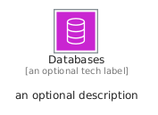
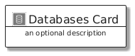
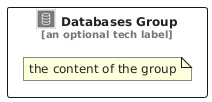

# Databases


```text
aws/Category/Databases
```

```text
include('aws/Category/Databases')
```


| Illustration | Databases | DatabasesCard | DatabasesGroup |
| :---: | :---: | :---: | :---: |
|  |  |  |  |


## Sprites
The item provides the following sriptes:

- `<$DatabasesXs>`
- `<$DatabasesSm>`
- `<$DatabasesMd>`
- `<$DatabasesLg>`


## Databases

### Load remotely
```plantuml
@startuml
' configures the library
!global $LIB_BASE_LOCATION="https://raw.githubusercontent.com/tmorin/plantuml-libs/master/distribution"

' loads the library's bootstrap
!include $LIB_BASE_LOCATION/bootstrap.puml

' loads the package bootstrap
include('aws/bootstrap')

' loads the Item which embeds the element Databases
include('aws/Category/Databases')

' renders the element
Databases('Databases', 'Databases', 'an optional tech label', 'an optional description')
@enduml
```

### Load locally
```plantuml
@startuml
' configures the library
!global $INCLUSION_MODE="local"
!global $LIB_BASE_LOCATION="../.."

' loads the library's bootstrap
!include $LIB_BASE_LOCATION/bootstrap.puml

' loads the package bootstrap
include('aws/bootstrap')

' loads the Item which embeds the element Databases
include('aws/Category/Databases')

' renders the element
Databases('Databases', 'Databases', 'an optional tech label', 'an optional description')
@enduml
```

## DatabasesCard

### Load remotely
```plantuml
@startuml
' configures the library
!global $LIB_BASE_LOCATION="https://raw.githubusercontent.com/tmorin/plantuml-libs/master/distribution"

' loads the library's bootstrap
!include $LIB_BASE_LOCATION/bootstrap.puml

' loads the package bootstrap
include('aws/bootstrap')

' loads the Item which embeds the element DatabasesCard
include('aws/Category/Databases')

' renders the element
DatabasesCard('DatabasesCard', 'Databases Card', 'an optional description')
@enduml
```

### Load locally
```plantuml
@startuml
' configures the library
!global $INCLUSION_MODE="local"
!global $LIB_BASE_LOCATION="../.."

' loads the library's bootstrap
!include $LIB_BASE_LOCATION/bootstrap.puml

' loads the package bootstrap
include('aws/bootstrap')

' loads the Item which embeds the element DatabasesCard
include('aws/Category/Databases')

' renders the element
DatabasesCard('DatabasesCard', 'Databases Card', 'an optional description')
@enduml
```

## DatabasesGroup

### Load remotely
```plantuml
@startuml
' configures the library
!global $LIB_BASE_LOCATION="https://raw.githubusercontent.com/tmorin/plantuml-libs/master/distribution"

' loads the library's bootstrap
!include $LIB_BASE_LOCATION/bootstrap.puml

' loads the package bootstrap
include('aws/bootstrap')

' loads the Item which embeds the element DatabasesGroup
include('aws/Category/Databases')

' renders the element
DatabasesGroup('DatabasesGroup', 'Databases Group', 'an optional tech label') {
    note as note
        the content of the group
    end note
}
@enduml
```

### Load locally
```plantuml
@startuml
' configures the library
!global $INCLUSION_MODE="local"
!global $LIB_BASE_LOCATION="../.."

' loads the library's bootstrap
!include $LIB_BASE_LOCATION/bootstrap.puml

' loads the package bootstrap
include('aws/bootstrap')

' loads the Item which embeds the element DatabasesGroup
include('aws/Category/Databases')

' renders the element
DatabasesGroup('DatabasesGroup', 'Databases Group', 'an optional tech label') {
    note as note
        the content of the group
    end note
}
@enduml
```

