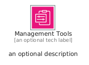
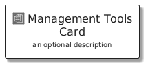
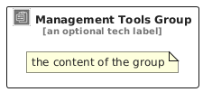

# ManagementTools


```text
aws/Category/ManagementTools
```

```text
include('aws/Category/ManagementTools')
```


| Illustration | ManagementTools | ManagementToolsCard | ManagementToolsGroup |
| :---: | :---: | :---: | :---: |
|  |  |  |  |


## Sprites
The item provides the following sriptes:

- `<$ManagementToolsXs>`
- `<$ManagementToolsSm>`
- `<$ManagementToolsMd>`
- `<$ManagementToolsLg>`


## ManagementTools

### Load remotely
```plantuml
@startuml
' configures the library
!global $LIB_BASE_LOCATION="https://raw.githubusercontent.com/tmorin/plantuml-libs/master/distribution"

' loads the library's bootstrap
!include $LIB_BASE_LOCATION/bootstrap.puml

' loads the package bootstrap
include('aws/bootstrap')

' loads the Item which embeds the element ManagementTools
include('aws/Category/ManagementTools')

' renders the element
ManagementTools('ManagementTools', 'Management Tools', 'an optional tech label', 'an optional description')
@enduml
```

### Load locally
```plantuml
@startuml
' configures the library
!global $INCLUSION_MODE="local"
!global $LIB_BASE_LOCATION="../.."

' loads the library's bootstrap
!include $LIB_BASE_LOCATION/bootstrap.puml

' loads the package bootstrap
include('aws/bootstrap')

' loads the Item which embeds the element ManagementTools
include('aws/Category/ManagementTools')

' renders the element
ManagementTools('ManagementTools', 'Management Tools', 'an optional tech label', 'an optional description')
@enduml
```

## ManagementToolsCard

### Load remotely
```plantuml
@startuml
' configures the library
!global $LIB_BASE_LOCATION="https://raw.githubusercontent.com/tmorin/plantuml-libs/master/distribution"

' loads the library's bootstrap
!include $LIB_BASE_LOCATION/bootstrap.puml

' loads the package bootstrap
include('aws/bootstrap')

' loads the Item which embeds the element ManagementToolsCard
include('aws/Category/ManagementTools')

' renders the element
ManagementToolsCard('ManagementToolsCard', 'Management Tools Card', 'an optional description')
@enduml
```

### Load locally
```plantuml
@startuml
' configures the library
!global $INCLUSION_MODE="local"
!global $LIB_BASE_LOCATION="../.."

' loads the library's bootstrap
!include $LIB_BASE_LOCATION/bootstrap.puml

' loads the package bootstrap
include('aws/bootstrap')

' loads the Item which embeds the element ManagementToolsCard
include('aws/Category/ManagementTools')

' renders the element
ManagementToolsCard('ManagementToolsCard', 'Management Tools Card', 'an optional description')
@enduml
```

## ManagementToolsGroup

### Load remotely
```plantuml
@startuml
' configures the library
!global $LIB_BASE_LOCATION="https://raw.githubusercontent.com/tmorin/plantuml-libs/master/distribution"

' loads the library's bootstrap
!include $LIB_BASE_LOCATION/bootstrap.puml

' loads the package bootstrap
include('aws/bootstrap')

' loads the Item which embeds the element ManagementToolsGroup
include('aws/Category/ManagementTools')

' renders the element
ManagementToolsGroup('ManagementToolsGroup', 'Management Tools Group', 'an optional tech label') {
    note as note
        the content of the group
    end note
}
@enduml
```

### Load locally
```plantuml
@startuml
' configures the library
!global $INCLUSION_MODE="local"
!global $LIB_BASE_LOCATION="../.."

' loads the library's bootstrap
!include $LIB_BASE_LOCATION/bootstrap.puml

' loads the package bootstrap
include('aws/bootstrap')

' loads the Item which embeds the element ManagementToolsGroup
include('aws/Category/ManagementTools')

' renders the element
ManagementToolsGroup('ManagementToolsGroup', 'Management Tools Group', 'an optional tech label') {
    note as note
        the content of the group
    end note
}
@enduml
```

