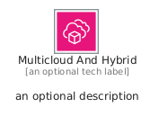
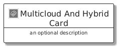
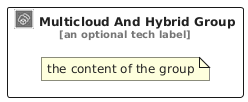

# MulticloudAndHybrid


```text
aws/Category/MulticloudAndHybrid
```

```text
include('aws/Category/MulticloudAndHybrid')
```


| Illustration | MulticloudAndHybrid | MulticloudAndHybridCard | MulticloudAndHybridGroup |
| :---: | :---: | :---: | :---: |
|  |  |  |  |


## Sprites
The item provides the following sriptes:

- `<$MulticloudAndHybridXs>`
- `<$MulticloudAndHybridSm>`
- `<$MulticloudAndHybridMd>`
- `<$MulticloudAndHybridLg>`


## MulticloudAndHybrid

### Load remotely
```plantuml
@startuml
' configures the library
!global $LIB_BASE_LOCATION="https://raw.githubusercontent.com/tmorin/plantuml-libs/master/distribution"

' loads the library's bootstrap
!include $LIB_BASE_LOCATION/bootstrap.puml

' loads the package bootstrap
include('aws/bootstrap')

' loads the Item which embeds the element MulticloudAndHybrid
include('aws/Category/MulticloudAndHybrid')

' renders the element
MulticloudAndHybrid('MulticloudAndHybrid', 'Multicloud And Hybrid', 'an optional tech label', 'an optional description')
@enduml
```

### Load locally
```plantuml
@startuml
' configures the library
!global $INCLUSION_MODE="local"
!global $LIB_BASE_LOCATION="../.."

' loads the library's bootstrap
!include $LIB_BASE_LOCATION/bootstrap.puml

' loads the package bootstrap
include('aws/bootstrap')

' loads the Item which embeds the element MulticloudAndHybrid
include('aws/Category/MulticloudAndHybrid')

' renders the element
MulticloudAndHybrid('MulticloudAndHybrid', 'Multicloud And Hybrid', 'an optional tech label', 'an optional description')
@enduml
```

## MulticloudAndHybridCard

### Load remotely
```plantuml
@startuml
' configures the library
!global $LIB_BASE_LOCATION="https://raw.githubusercontent.com/tmorin/plantuml-libs/master/distribution"

' loads the library's bootstrap
!include $LIB_BASE_LOCATION/bootstrap.puml

' loads the package bootstrap
include('aws/bootstrap')

' loads the Item which embeds the element MulticloudAndHybridCard
include('aws/Category/MulticloudAndHybrid')

' renders the element
MulticloudAndHybridCard('MulticloudAndHybridCard', 'Multicloud And Hybrid Card', 'an optional description')
@enduml
```

### Load locally
```plantuml
@startuml
' configures the library
!global $INCLUSION_MODE="local"
!global $LIB_BASE_LOCATION="../.."

' loads the library's bootstrap
!include $LIB_BASE_LOCATION/bootstrap.puml

' loads the package bootstrap
include('aws/bootstrap')

' loads the Item which embeds the element MulticloudAndHybridCard
include('aws/Category/MulticloudAndHybrid')

' renders the element
MulticloudAndHybridCard('MulticloudAndHybridCard', 'Multicloud And Hybrid Card', 'an optional description')
@enduml
```

## MulticloudAndHybridGroup

### Load remotely
```plantuml
@startuml
' configures the library
!global $LIB_BASE_LOCATION="https://raw.githubusercontent.com/tmorin/plantuml-libs/master/distribution"

' loads the library's bootstrap
!include $LIB_BASE_LOCATION/bootstrap.puml

' loads the package bootstrap
include('aws/bootstrap')

' loads the Item which embeds the element MulticloudAndHybridGroup
include('aws/Category/MulticloudAndHybrid')

' renders the element
MulticloudAndHybridGroup('MulticloudAndHybridGroup', 'Multicloud And Hybrid Group', 'an optional tech label') {
    note as note
        the content of the group
    end note
}
@enduml
```

### Load locally
```plantuml
@startuml
' configures the library
!global $INCLUSION_MODE="local"
!global $LIB_BASE_LOCATION="../.."

' loads the library's bootstrap
!include $LIB_BASE_LOCATION/bootstrap.puml

' loads the package bootstrap
include('aws/bootstrap')

' loads the Item which embeds the element MulticloudAndHybridGroup
include('aws/Category/MulticloudAndHybrid')

' renders the element
MulticloudAndHybridGroup('MulticloudAndHybridGroup', 'Multicloud And Hybrid Group', 'an optional tech label') {
    note as note
        the content of the group
    end note
}
@enduml
```

