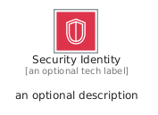
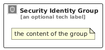

# SecurityIdentity


```text
aws/Category/SecurityIdentity
```

```text
include('aws/Category/SecurityIdentity')
```


| Illustration | SecurityIdentity | SecurityIdentityCard | SecurityIdentityGroup |
| :---: | :---: | :---: | :---: |
|  |  |  |  |


## Sprites
The item provides the following sriptes:

- `<$SecurityIdentityXs>`
- `<$SecurityIdentitySm>`
- `<$SecurityIdentityMd>`
- `<$SecurityIdentityLg>`


## SecurityIdentity

### Load remotely
```plantuml
@startuml
' configures the library
!global $LIB_BASE_LOCATION="https://raw.githubusercontent.com/tmorin/plantuml-libs/master/distribution"

' loads the library's bootstrap
!include $LIB_BASE_LOCATION/bootstrap.puml

' loads the package bootstrap
include('aws/bootstrap')

' loads the Item which embeds the element SecurityIdentity
include('aws/Category/SecurityIdentity')

' renders the element
SecurityIdentity('SecurityIdentity', 'Security Identity', 'an optional tech label', 'an optional description')
@enduml
```

### Load locally
```plantuml
@startuml
' configures the library
!global $INCLUSION_MODE="local"
!global $LIB_BASE_LOCATION="../.."

' loads the library's bootstrap
!include $LIB_BASE_LOCATION/bootstrap.puml

' loads the package bootstrap
include('aws/bootstrap')

' loads the Item which embeds the element SecurityIdentity
include('aws/Category/SecurityIdentity')

' renders the element
SecurityIdentity('SecurityIdentity', 'Security Identity', 'an optional tech label', 'an optional description')
@enduml
```

## SecurityIdentityCard

### Load remotely
```plantuml
@startuml
' configures the library
!global $LIB_BASE_LOCATION="https://raw.githubusercontent.com/tmorin/plantuml-libs/master/distribution"

' loads the library's bootstrap
!include $LIB_BASE_LOCATION/bootstrap.puml

' loads the package bootstrap
include('aws/bootstrap')

' loads the Item which embeds the element SecurityIdentityCard
include('aws/Category/SecurityIdentity')

' renders the element
SecurityIdentityCard('SecurityIdentityCard', 'Security Identity Card', 'an optional description')
@enduml
```

### Load locally
```plantuml
@startuml
' configures the library
!global $INCLUSION_MODE="local"
!global $LIB_BASE_LOCATION="../.."

' loads the library's bootstrap
!include $LIB_BASE_LOCATION/bootstrap.puml

' loads the package bootstrap
include('aws/bootstrap')

' loads the Item which embeds the element SecurityIdentityCard
include('aws/Category/SecurityIdentity')

' renders the element
SecurityIdentityCard('SecurityIdentityCard', 'Security Identity Card', 'an optional description')
@enduml
```

## SecurityIdentityGroup

### Load remotely
```plantuml
@startuml
' configures the library
!global $LIB_BASE_LOCATION="https://raw.githubusercontent.com/tmorin/plantuml-libs/master/distribution"

' loads the library's bootstrap
!include $LIB_BASE_LOCATION/bootstrap.puml

' loads the package bootstrap
include('aws/bootstrap')

' loads the Item which embeds the element SecurityIdentityGroup
include('aws/Category/SecurityIdentity')

' renders the element
SecurityIdentityGroup('SecurityIdentityGroup', 'Security Identity Group', 'an optional tech label') {
    note as note
        the content of the group
    end note
}
@enduml
```

### Load locally
```plantuml
@startuml
' configures the library
!global $INCLUSION_MODE="local"
!global $LIB_BASE_LOCATION="../.."

' loads the library's bootstrap
!include $LIB_BASE_LOCATION/bootstrap.puml

' loads the package bootstrap
include('aws/bootstrap')

' loads the Item which embeds the element SecurityIdentityGroup
include('aws/Category/SecurityIdentity')

' renders the element
SecurityIdentityGroup('SecurityIdentityGroup', 'Security Identity Group', 'an optional tech label') {
    note as note
        the content of the group
    end note
}
@enduml
```

