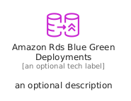
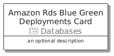
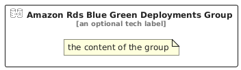

# AmazonRdsBlueGreenDeployments


```text
aws/Resource/Databases/AmazonRdsBlueGreenDeployments
```

```text
include('aws/Resource/Databases/AmazonRdsBlueGreenDeployments')
```


| Illustration | AmazonRdsBlueGreenDeployments | AmazonRdsBlueGreenDeploymentsCard | AmazonRdsBlueGreenDeploymentsGroup |
| :---: | :---: | :---: | :---: |
|  |  |  |  |


## Sprites
The item provides the following sriptes:

- `<$AmazonRdsBlueGreenDeploymentsXs>`
- `<$AmazonRdsBlueGreenDeploymentsSm>`
- `<$AmazonRdsBlueGreenDeploymentsMd>`
- `<$AmazonRdsBlueGreenDeploymentsLg>`


## AmazonRdsBlueGreenDeployments

### Load remotely
```plantuml
@startuml
' configures the library
!global $LIB_BASE_LOCATION="https://raw.githubusercontent.com/tmorin/plantuml-libs/master/distribution"

' loads the library's bootstrap
!include $LIB_BASE_LOCATION/bootstrap.puml

' loads the package bootstrap
include('aws/bootstrap')

' loads the Item which embeds the element AmazonRdsBlueGreenDeployments
include('aws/Resource/Databases/AmazonRdsBlueGreenDeployments')

' renders the element
AmazonRdsBlueGreenDeployments('AmazonRdsBlueGreenDeployments', 'Amazon Rds Blue Green Deployments', 'an optional tech label', 'an optional description')
@enduml
```

### Load locally
```plantuml
@startuml
' configures the library
!global $INCLUSION_MODE="local"
!global $LIB_BASE_LOCATION="../../.."

' loads the library's bootstrap
!include $LIB_BASE_LOCATION/bootstrap.puml

' loads the package bootstrap
include('aws/bootstrap')

' loads the Item which embeds the element AmazonRdsBlueGreenDeployments
include('aws/Resource/Databases/AmazonRdsBlueGreenDeployments')

' renders the element
AmazonRdsBlueGreenDeployments('AmazonRdsBlueGreenDeployments', 'Amazon Rds Blue Green Deployments', 'an optional tech label', 'an optional description')
@enduml
```

## AmazonRdsBlueGreenDeploymentsCard

### Load remotely
```plantuml
@startuml
' configures the library
!global $LIB_BASE_LOCATION="https://raw.githubusercontent.com/tmorin/plantuml-libs/master/distribution"

' loads the library's bootstrap
!include $LIB_BASE_LOCATION/bootstrap.puml

' loads the package bootstrap
include('aws/bootstrap')

' loads the Item which embeds the element AmazonRdsBlueGreenDeploymentsCard
include('aws/Resource/Databases/AmazonRdsBlueGreenDeployments')

' renders the element
AmazonRdsBlueGreenDeploymentsCard('AmazonRdsBlueGreenDeploymentsCard', 'Amazon Rds Blue Green Deployments Card', 'an optional description')
@enduml
```

### Load locally
```plantuml
@startuml
' configures the library
!global $INCLUSION_MODE="local"
!global $LIB_BASE_LOCATION="../../.."

' loads the library's bootstrap
!include $LIB_BASE_LOCATION/bootstrap.puml

' loads the package bootstrap
include('aws/bootstrap')

' loads the Item which embeds the element AmazonRdsBlueGreenDeploymentsCard
include('aws/Resource/Databases/AmazonRdsBlueGreenDeployments')

' renders the element
AmazonRdsBlueGreenDeploymentsCard('AmazonRdsBlueGreenDeploymentsCard', 'Amazon Rds Blue Green Deployments Card', 'an optional description')
@enduml
```

## AmazonRdsBlueGreenDeploymentsGroup

### Load remotely
```plantuml
@startuml
' configures the library
!global $LIB_BASE_LOCATION="https://raw.githubusercontent.com/tmorin/plantuml-libs/master/distribution"

' loads the library's bootstrap
!include $LIB_BASE_LOCATION/bootstrap.puml

' loads the package bootstrap
include('aws/bootstrap')

' loads the Item which embeds the element AmazonRdsBlueGreenDeploymentsGroup
include('aws/Resource/Databases/AmazonRdsBlueGreenDeployments')

' renders the element
AmazonRdsBlueGreenDeploymentsGroup('AmazonRdsBlueGreenDeploymentsGroup', 'Amazon Rds Blue Green Deployments Group', 'an optional tech label') {
    note as note
        the content of the group
    end note
}
@enduml
```

### Load locally
```plantuml
@startuml
' configures the library
!global $INCLUSION_MODE="local"
!global $LIB_BASE_LOCATION="../../.."

' loads the library's bootstrap
!include $LIB_BASE_LOCATION/bootstrap.puml

' loads the package bootstrap
include('aws/bootstrap')

' loads the Item which embeds the element AmazonRdsBlueGreenDeploymentsGroup
include('aws/Resource/Databases/AmazonRdsBlueGreenDeployments')

' renders the element
AmazonRdsBlueGreenDeploymentsGroup('AmazonRdsBlueGreenDeploymentsGroup', 'Amazon Rds Blue Green Deployments Group', 'an optional tech label') {
    note as note
        the content of the group
    end note
}
@enduml
```

