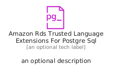
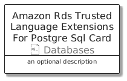
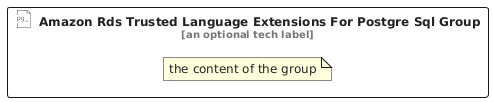

# AmazonRdsTrustedLanguageExtensionsForPostgreSql


```text
aws/Resource/Databases/AmazonRdsTrustedLanguageExtensionsForPostgreSql
```

```text
include('aws/Resource/Databases/AmazonRdsTrustedLanguageExtensionsForPostgreSql')
```


| Illustration | AmazonRdsTrustedLanguageExtensionsForPostgreSql | AmazonRdsTrustedLanguageExtensionsForPostgreSqlCard | AmazonRdsTrustedLanguageExtensionsForPostgreSqlGroup |
| :---: | :---: | :---: | :---: |
|  |  |  |  |


## Sprites
The item provides the following sriptes:

- `<$AmazonRdsTrustedLanguageExtensionsForPostgreSqlXs>`
- `<$AmazonRdsTrustedLanguageExtensionsForPostgreSqlSm>`
- `<$AmazonRdsTrustedLanguageExtensionsForPostgreSqlMd>`
- `<$AmazonRdsTrustedLanguageExtensionsForPostgreSqlLg>`


## AmazonRdsTrustedLanguageExtensionsForPostgreSql

### Load remotely
```plantuml
@startuml
' configures the library
!global $LIB_BASE_LOCATION="https://raw.githubusercontent.com/tmorin/plantuml-libs/master/distribution"

' loads the library's bootstrap
!include $LIB_BASE_LOCATION/bootstrap.puml

' loads the package bootstrap
include('aws/bootstrap')

' loads the Item which embeds the element AmazonRdsTrustedLanguageExtensionsForPostgreSql
include('aws/Resource/Databases/AmazonRdsTrustedLanguageExtensionsForPostgreSql')

' renders the element
AmazonRdsTrustedLanguageExtensionsForPostgreSql('AmazonRdsTrustedLanguageExtensionsForPostgreSql', 'Amazon Rds Trusted Language Extensions For Postgre Sql', 'an optional tech label', 'an optional description')
@enduml
```

### Load locally
```plantuml
@startuml
' configures the library
!global $INCLUSION_MODE="local"
!global $LIB_BASE_LOCATION="../../.."

' loads the library's bootstrap
!include $LIB_BASE_LOCATION/bootstrap.puml

' loads the package bootstrap
include('aws/bootstrap')

' loads the Item which embeds the element AmazonRdsTrustedLanguageExtensionsForPostgreSql
include('aws/Resource/Databases/AmazonRdsTrustedLanguageExtensionsForPostgreSql')

' renders the element
AmazonRdsTrustedLanguageExtensionsForPostgreSql('AmazonRdsTrustedLanguageExtensionsForPostgreSql', 'Amazon Rds Trusted Language Extensions For Postgre Sql', 'an optional tech label', 'an optional description')
@enduml
```

## AmazonRdsTrustedLanguageExtensionsForPostgreSqlCard

### Load remotely
```plantuml
@startuml
' configures the library
!global $LIB_BASE_LOCATION="https://raw.githubusercontent.com/tmorin/plantuml-libs/master/distribution"

' loads the library's bootstrap
!include $LIB_BASE_LOCATION/bootstrap.puml

' loads the package bootstrap
include('aws/bootstrap')

' loads the Item which embeds the element AmazonRdsTrustedLanguageExtensionsForPostgreSqlCard
include('aws/Resource/Databases/AmazonRdsTrustedLanguageExtensionsForPostgreSql')

' renders the element
AmazonRdsTrustedLanguageExtensionsForPostgreSqlCard('AmazonRdsTrustedLanguageExtensionsForPostgreSqlCard', 'Amazon Rds Trusted Language Extensions For Postgre Sql Card', 'an optional description')
@enduml
```

### Load locally
```plantuml
@startuml
' configures the library
!global $INCLUSION_MODE="local"
!global $LIB_BASE_LOCATION="../../.."

' loads the library's bootstrap
!include $LIB_BASE_LOCATION/bootstrap.puml

' loads the package bootstrap
include('aws/bootstrap')

' loads the Item which embeds the element AmazonRdsTrustedLanguageExtensionsForPostgreSqlCard
include('aws/Resource/Databases/AmazonRdsTrustedLanguageExtensionsForPostgreSql')

' renders the element
AmazonRdsTrustedLanguageExtensionsForPostgreSqlCard('AmazonRdsTrustedLanguageExtensionsForPostgreSqlCard', 'Amazon Rds Trusted Language Extensions For Postgre Sql Card', 'an optional description')
@enduml
```

## AmazonRdsTrustedLanguageExtensionsForPostgreSqlGroup

### Load remotely
```plantuml
@startuml
' configures the library
!global $LIB_BASE_LOCATION="https://raw.githubusercontent.com/tmorin/plantuml-libs/master/distribution"

' loads the library's bootstrap
!include $LIB_BASE_LOCATION/bootstrap.puml

' loads the package bootstrap
include('aws/bootstrap')

' loads the Item which embeds the element AmazonRdsTrustedLanguageExtensionsForPostgreSqlGroup
include('aws/Resource/Databases/AmazonRdsTrustedLanguageExtensionsForPostgreSql')

' renders the element
AmazonRdsTrustedLanguageExtensionsForPostgreSqlGroup('AmazonRdsTrustedLanguageExtensionsForPostgreSqlGroup', 'Amazon Rds Trusted Language Extensions For Postgre Sql Group', 'an optional tech label') {
    note as note
        the content of the group
    end note
}
@enduml
```

### Load locally
```plantuml
@startuml
' configures the library
!global $INCLUSION_MODE="local"
!global $LIB_BASE_LOCATION="../../.."

' loads the library's bootstrap
!include $LIB_BASE_LOCATION/bootstrap.puml

' loads the package bootstrap
include('aws/bootstrap')

' loads the Item which embeds the element AmazonRdsTrustedLanguageExtensionsForPostgreSqlGroup
include('aws/Resource/Databases/AmazonRdsTrustedLanguageExtensionsForPostgreSql')

' renders the element
AmazonRdsTrustedLanguageExtensionsForPostgreSqlGroup('AmazonRdsTrustedLanguageExtensionsForPostgreSqlGroup', 'Amazon Rds Trusted Language Extensions For Postgre Sql Group', 'an optional tech label') {
    note as note
        the content of the group
    end note
}
@enduml
```

