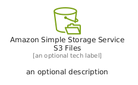
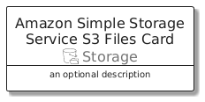
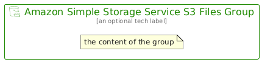

# AmazonSimpleStorageServiceS3Files


```text
aws/Resource/Storage/AmazonSimpleStorageServiceS3Files
```

```text
include('aws/Resource/Storage/AmazonSimpleStorageServiceS3Files')
```


| Illustration | AmazonSimpleStorageServiceS3Files | AmazonSimpleStorageServiceS3FilesCard | AmazonSimpleStorageServiceS3FilesGroup |
| :---: | :---: | :---: | :---: |
|  |  |  |  |


## Sprites
The item provides the following sriptes:

- `<$AmazonSimpleStorageServiceS3FilesXs>`
- `<$AmazonSimpleStorageServiceS3FilesSm>`
- `<$AmazonSimpleStorageServiceS3FilesMd>`
- `<$AmazonSimpleStorageServiceS3FilesLg>`


## AmazonSimpleStorageServiceS3Files

### Load remotely
```plantuml
@startuml
' configures the library
!global $LIB_BASE_LOCATION="https://raw.githubusercontent.com/tmorin/plantuml-libs/master/distribution"

' loads the library's bootstrap
!include $LIB_BASE_LOCATION/bootstrap.puml

' loads the package bootstrap
include('aws/bootstrap')

' loads the Item which embeds the element AmazonSimpleStorageServiceS3Files
include('aws/Resource/Storage/AmazonSimpleStorageServiceS3Files')

' renders the element
AmazonSimpleStorageServiceS3Files('AmazonSimpleStorageServiceS3Files', 'Amazon Simple Storage Service S3 Files', 'an optional tech label', 'an optional description')
@enduml
```

### Load locally
```plantuml
@startuml
' configures the library
!global $INCLUSION_MODE="local"
!global $LIB_BASE_LOCATION="../../.."

' loads the library's bootstrap
!include $LIB_BASE_LOCATION/bootstrap.puml

' loads the package bootstrap
include('aws/bootstrap')

' loads the Item which embeds the element AmazonSimpleStorageServiceS3Files
include('aws/Resource/Storage/AmazonSimpleStorageServiceS3Files')

' renders the element
AmazonSimpleStorageServiceS3Files('AmazonSimpleStorageServiceS3Files', 'Amazon Simple Storage Service S3 Files', 'an optional tech label', 'an optional description')
@enduml
```

## AmazonSimpleStorageServiceS3FilesCard

### Load remotely
```plantuml
@startuml
' configures the library
!global $LIB_BASE_LOCATION="https://raw.githubusercontent.com/tmorin/plantuml-libs/master/distribution"

' loads the library's bootstrap
!include $LIB_BASE_LOCATION/bootstrap.puml

' loads the package bootstrap
include('aws/bootstrap')

' loads the Item which embeds the element AmazonSimpleStorageServiceS3FilesCard
include('aws/Resource/Storage/AmazonSimpleStorageServiceS3Files')

' renders the element
AmazonSimpleStorageServiceS3FilesCard('AmazonSimpleStorageServiceS3FilesCard', 'Amazon Simple Storage Service S3 Files Card', 'an optional description')
@enduml
```

### Load locally
```plantuml
@startuml
' configures the library
!global $INCLUSION_MODE="local"
!global $LIB_BASE_LOCATION="../../.."

' loads the library's bootstrap
!include $LIB_BASE_LOCATION/bootstrap.puml

' loads the package bootstrap
include('aws/bootstrap')

' loads the Item which embeds the element AmazonSimpleStorageServiceS3FilesCard
include('aws/Resource/Storage/AmazonSimpleStorageServiceS3Files')

' renders the element
AmazonSimpleStorageServiceS3FilesCard('AmazonSimpleStorageServiceS3FilesCard', 'Amazon Simple Storage Service S3 Files Card', 'an optional description')
@enduml
```

## AmazonSimpleStorageServiceS3FilesGroup

### Load remotely
```plantuml
@startuml
' configures the library
!global $LIB_BASE_LOCATION="https://raw.githubusercontent.com/tmorin/plantuml-libs/master/distribution"

' loads the library's bootstrap
!include $LIB_BASE_LOCATION/bootstrap.puml

' loads the package bootstrap
include('aws/bootstrap')

' loads the Item which embeds the element AmazonSimpleStorageServiceS3FilesGroup
include('aws/Resource/Storage/AmazonSimpleStorageServiceS3Files')

' renders the element
AmazonSimpleStorageServiceS3FilesGroup('AmazonSimpleStorageServiceS3FilesGroup', 'Amazon Simple Storage Service S3 Files Group', 'an optional tech label') {
    note as note
        the content of the group
    end note
}
@enduml
```

### Load locally
```plantuml
@startuml
' configures the library
!global $INCLUSION_MODE="local"
!global $LIB_BASE_LOCATION="../../.."

' loads the library's bootstrap
!include $LIB_BASE_LOCATION/bootstrap.puml

' loads the package bootstrap
include('aws/bootstrap')

' loads the Item which embeds the element AmazonSimpleStorageServiceS3FilesGroup
include('aws/Resource/Storage/AmazonSimpleStorageServiceS3Files')

' renders the element
AmazonSimpleStorageServiceS3FilesGroup('AmazonSimpleStorageServiceS3FilesGroup', 'Amazon Simple Storage Service S3 Files Group', 'an optional tech label') {
    note as note
        the content of the group
    end note
}
@enduml
```

