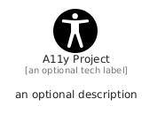

# A11YProject


```text
fontawesome/Brands/A11YProject
```

```text
include('fontawesome/Brands/A11YProject')
```


| Illustration | A11YProject |
| :---: | :---: |
|  |  |


## Sprites
The item provides the following sriptes:

- `<$A11YProjectXs>`
- `<$A11YProjectSm>`
- `<$A11YProjectMd>`
- `<$A11YProjectLg>`


## A11YProject

### Load remotely
```plantuml
@startuml
' configures the library
!global $LIB_BASE_LOCATION="https://raw.githubusercontent.com/tmorin/plantuml-libs/master/distribution"

' loads the library's bootstrap
!include $LIB_BASE_LOCATION/bootstrap.puml

' loads the package bootstrap
include('fontawesome/bootstrap')

' loads the Item which embeds the element A11YProject
include('fontawesome/Brands/A11YProject')

' renders the element
A11YProject('A11yProject', 'A11y Project', 'an optional tech label', 'an optional description')
@enduml
```

### Load locally
```plantuml
@startuml
' configures the library
!global $INCLUSION_MODE="local"
!global $LIB_BASE_LOCATION="../.."

' loads the library's bootstrap
!include $LIB_BASE_LOCATION/bootstrap.puml

' loads the package bootstrap
include('fontawesome/bootstrap')

' loads the Item which embeds the element A11YProject
include('fontawesome/Brands/A11YProject')

' renders the element
A11YProject('A11yProject', 'A11y Project', 'an optional tech label', 'an optional description')
@enduml
```

