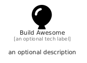

# BuildAwesome


```text
fontawesome/Brands/BuildAwesome
```

```text
include('fontawesome/Brands/BuildAwesome')
```


| Illustration | BuildAwesome |
| :---: | :---: |
|  |  |


## Sprites
The item provides the following sriptes:

- `<$BuildAwesomeXs>`
- `<$BuildAwesomeSm>`
- `<$BuildAwesomeMd>`
- `<$BuildAwesomeLg>`


## BuildAwesome

### Load remotely
```plantuml
@startuml
' configures the library
!global $LIB_BASE_LOCATION="https://raw.githubusercontent.com/tmorin/plantuml-libs/master/distribution"

' loads the library's bootstrap
!include $LIB_BASE_LOCATION/bootstrap.puml

' loads the package bootstrap
include('fontawesome/bootstrap')

' loads the Item which embeds the element BuildAwesome
include('fontawesome/Brands/BuildAwesome')

' renders the element
BuildAwesome('BuildAwesome', 'Build Awesome', 'an optional tech label', 'an optional description')
@enduml
```

### Load locally
```plantuml
@startuml
' configures the library
!global $INCLUSION_MODE="local"
!global $LIB_BASE_LOCATION="../.."

' loads the library's bootstrap
!include $LIB_BASE_LOCATION/bootstrap.puml

' loads the package bootstrap
include('fontawesome/bootstrap')

' loads the Item which embeds the element BuildAwesome
include('fontawesome/Brands/BuildAwesome')

' renders the element
BuildAwesome('BuildAwesome', 'Build Awesome', 'an optional tech label', 'an optional description')
@enduml
```

