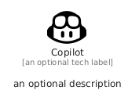

# Copilot


```text
fontawesome/Brands/Copilot
```

```text
include('fontawesome/Brands/Copilot')
```


| Illustration | Copilot |
| :---: | :---: |
|  |  |


## Sprites
The item provides the following sriptes:

- `<$CopilotXs>`
- `<$CopilotSm>`
- `<$CopilotMd>`
- `<$CopilotLg>`


## Copilot

### Load remotely
```plantuml
@startuml
' configures the library
!global $LIB_BASE_LOCATION="https://raw.githubusercontent.com/tmorin/plantuml-libs/master/distribution"

' loads the library's bootstrap
!include $LIB_BASE_LOCATION/bootstrap.puml

' loads the package bootstrap
include('fontawesome/bootstrap')

' loads the Item which embeds the element Copilot
include('fontawesome/Brands/Copilot')

' renders the element
Copilot('Copilot', 'Copilot', 'an optional tech label', 'an optional description')
@enduml
```

### Load locally
```plantuml
@startuml
' configures the library
!global $INCLUSION_MODE="local"
!global $LIB_BASE_LOCATION="../.."

' loads the library's bootstrap
!include $LIB_BASE_LOCATION/bootstrap.puml

' loads the package bootstrap
include('fontawesome/bootstrap')

' loads the Item which embeds the element Copilot
include('fontawesome/Brands/Copilot')

' renders the element
Copilot('Copilot', 'Copilot', 'an optional tech label', 'an optional description')
@enduml
```

