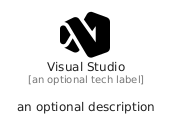

# VisualStudio


```text
fontawesome/Brands/VisualStudio
```

```text
include('fontawesome/Brands/VisualStudio')
```


| Illustration | VisualStudio |
| :---: | :---: |
|  |  |


## Sprites
The item provides the following sriptes:

- `<$VisualStudioXs>`
- `<$VisualStudioSm>`
- `<$VisualStudioMd>`
- `<$VisualStudioLg>`


## VisualStudio

### Load remotely
```plantuml
@startuml
' configures the library
!global $LIB_BASE_LOCATION="https://raw.githubusercontent.com/tmorin/plantuml-libs/master/distribution"

' loads the library's bootstrap
!include $LIB_BASE_LOCATION/bootstrap.puml

' loads the package bootstrap
include('fontawesome/bootstrap')

' loads the Item which embeds the element VisualStudio
include('fontawesome/Brands/VisualStudio')

' renders the element
VisualStudio('VisualStudio', 'Visual Studio', 'an optional tech label', 'an optional description')
@enduml
```

### Load locally
```plantuml
@startuml
' configures the library
!global $INCLUSION_MODE="local"
!global $LIB_BASE_LOCATION="../.."

' loads the library's bootstrap
!include $LIB_BASE_LOCATION/bootstrap.puml

' loads the package bootstrap
include('fontawesome/bootstrap')

' loads the Item which embeds the element VisualStudio
include('fontawesome/Brands/VisualStudio')

' renders the element
VisualStudio('VisualStudio', 'Visual Studio', 'an optional tech label', 'an optional description')
@enduml
```

