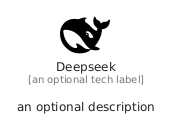

# Deepseek


```text
simpleicons/D/Deepseek
```

```text
include('simpleicons/D/Deepseek')
```


| Illustration | Deepseek |
| :---: | :---: |
|  |  |


## Sprites
The item provides the following sriptes:

- `<$DeepseekXs>`
- `<$DeepseekSm>`
- `<$DeepseekMd>`
- `<$DeepseekLg>`


## Deepseek

### Load remotely
```plantuml
@startuml
' configures the library
!global $LIB_BASE_LOCATION="https://raw.githubusercontent.com/tmorin/plantuml-libs/master/distribution"

' loads the library's bootstrap
!include $LIB_BASE_LOCATION/bootstrap.puml

' loads the package bootstrap
include('simpleicons/bootstrap')

' loads the Item which embeds the element Deepseek
include('simpleicons/D/Deepseek')

' renders the element
Deepseek('Deepseek', 'Deepseek', 'an optional tech label', 'an optional description')
@enduml
```

### Load locally
```plantuml
@startuml
' configures the library
!global $INCLUSION_MODE="local"
!global $LIB_BASE_LOCATION="../.."

' loads the library's bootstrap
!include $LIB_BASE_LOCATION/bootstrap.puml

' loads the package bootstrap
include('simpleicons/bootstrap')

' loads the Item which embeds the element Deepseek
include('simpleicons/D/Deepseek')

' renders the element
Deepseek('Deepseek', 'Deepseek', 'an optional tech label', 'an optional description')
@enduml
```

