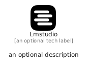

# Lmstudio


```text
simpleicons/L/Lmstudio
```

```text
include('simpleicons/L/Lmstudio')
```


| Illustration | Lmstudio |
| :---: | :---: |
|  |  |


## Sprites
The item provides the following sriptes:

- `<$LmstudioXs>`
- `<$LmstudioSm>`
- `<$LmstudioMd>`
- `<$LmstudioLg>`


## Lmstudio

### Load remotely
```plantuml
@startuml
' configures the library
!global $LIB_BASE_LOCATION="https://raw.githubusercontent.com/tmorin/plantuml-libs/master/distribution"

' loads the library's bootstrap
!include $LIB_BASE_LOCATION/bootstrap.puml

' loads the package bootstrap
include('simpleicons/bootstrap')

' loads the Item which embeds the element Lmstudio
include('simpleicons/L/Lmstudio')

' renders the element
Lmstudio('Lmstudio', 'Lmstudio', 'an optional tech label', 'an optional description')
@enduml
```

### Load locally
```plantuml
@startuml
' configures the library
!global $INCLUSION_MODE="local"
!global $LIB_BASE_LOCATION="../.."

' loads the library's bootstrap
!include $LIB_BASE_LOCATION/bootstrap.puml

' loads the package bootstrap
include('simpleicons/bootstrap')

' loads the Item which embeds the element Lmstudio
include('simpleicons/L/Lmstudio')

' renders the element
Lmstudio('Lmstudio', 'Lmstudio', 'an optional tech label', 'an optional description')
@enduml
```

