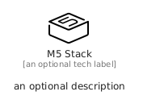

# M5Stack


```text
simpleicons/M/M5Stack
```

```text
include('simpleicons/M/M5Stack')
```


| Illustration | M5Stack |
| :---: | :---: |
|  |  |


## Sprites
The item provides the following sriptes:

- `<$M5StackXs>`
- `<$M5StackSm>`
- `<$M5StackMd>`
- `<$M5StackLg>`


## M5Stack

### Load remotely
```plantuml
@startuml
' configures the library
!global $LIB_BASE_LOCATION="https://raw.githubusercontent.com/tmorin/plantuml-libs/master/distribution"

' loads the library's bootstrap
!include $LIB_BASE_LOCATION/bootstrap.puml

' loads the package bootstrap
include('simpleicons/bootstrap')

' loads the Item which embeds the element M5Stack
include('simpleicons/M/M5Stack')

' renders the element
M5Stack('M5Stack', 'M5 Stack', 'an optional tech label', 'an optional description')
@enduml
```

### Load locally
```plantuml
@startuml
' configures the library
!global $INCLUSION_MODE="local"
!global $LIB_BASE_LOCATION="../.."

' loads the library's bootstrap
!include $LIB_BASE_LOCATION/bootstrap.puml

' loads the package bootstrap
include('simpleicons/bootstrap')

' loads the Item which embeds the element M5Stack
include('simpleicons/M/M5Stack')

' renders the element
M5Stack('M5Stack', 'M5 Stack', 'an optional tech label', 'an optional description')
@enduml
```

