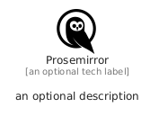

# Prosemirror


```text
simpleicons/P/Prosemirror
```

```text
include('simpleicons/P/Prosemirror')
```


| Illustration | Prosemirror |
| :---: | :---: |
|  |  |


## Sprites
The item provides the following sriptes:

- `<$ProsemirrorXs>`
- `<$ProsemirrorSm>`
- `<$ProsemirrorMd>`
- `<$ProsemirrorLg>`


## Prosemirror

### Load remotely
```plantuml
@startuml
' configures the library
!global $LIB_BASE_LOCATION="https://raw.githubusercontent.com/tmorin/plantuml-libs/master/distribution"

' loads the library's bootstrap
!include $LIB_BASE_LOCATION/bootstrap.puml

' loads the package bootstrap
include('simpleicons/bootstrap')

' loads the Item which embeds the element Prosemirror
include('simpleicons/P/Prosemirror')

' renders the element
Prosemirror('Prosemirror', 'Prosemirror', 'an optional tech label', 'an optional description')
@enduml
```

### Load locally
```plantuml
@startuml
' configures the library
!global $INCLUSION_MODE="local"
!global $LIB_BASE_LOCATION="../.."

' loads the library's bootstrap
!include $LIB_BASE_LOCATION/bootstrap.puml

' loads the package bootstrap
include('simpleicons/bootstrap')

' loads the Item which embeds the element Prosemirror
include('simpleicons/P/Prosemirror')

' renders the element
Prosemirror('Prosemirror', 'Prosemirror', 'an optional tech label', 'an optional description')
@enduml
```

