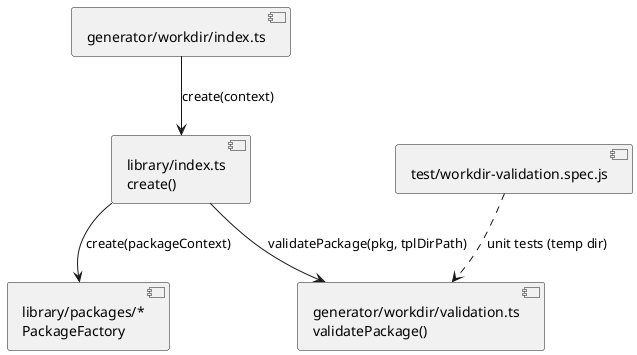
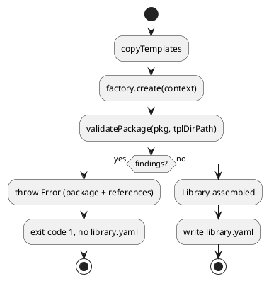

# Workdir reference validation

# Summary

`npm run generate:workdir` writes `.workdir/library.yaml` without checking that the
references inside it point at anything. A package that declares an example
`template` absent from the template directory, or an item icon of type `Reference`
whose `urn` matches no item, is only discovered after a full render of the
package (wave 002 hit this on CI with a stale `groups.csv` reference). This design
adds a pure validation step run on each package right after its factory returns,
which throws one error naming the package and every broken reference.

# Scope

In scope: a new `source/generator/workdir/validation.ts`, its call from
`source/library/index.ts`, and a test file under `test/`.

Out of scope: wave 003's W-2 (`archive.ts`) and W-3 (AWS families, resolver),
the website stages, `Source` icons, and any change to package factories.

# PRD Traceability

**Traceability is incomplete. There is no PRD**, by design: the run uses the
`TDD+pln` profile. Requirements come from the wave manifest
(`wav-003-workdir-generation-hardening.md`, run `W-1`, phase P1 gate). They are
labelled `WR-n`; they are sourced, not invented, but they are not PRD IDs.

| ID | Requirement (source) | Addressed by |
|---|---|---|
| `WR-1` | After a package is created, each declared example `template` exists under the template directory the pipeline reads (W-1 scope) | `DEC-1`, `DEC-2`, `IMP-1` |
| `WR-2` | Each item `icon` of type `Reference` has a `urn` that resolves to an item of the generated library (W-1 scope). Read here as "an item of the same package", see `DEC-3` | `DEC-1`, `DEC-3`, `IMP-1` |
| `WR-3` | The error names the package and the broken reference (W-1 exit evidence, P1 gate) | `DEC-4`, `CTR-1` |
| `WR-4` | Two tests, a missing example template and a dangling `icon_reference`, each make the generator throw; they run in `npm test` without network access (W-1 exit evidence, P1 gate). Read here as "make `validatePackage`, the function `create()` calls, throw"; the call site itself is covered by the all-package run (`RISK-2`, `DEF-1`) | `DEC-5`, `IMP-2` |
| `WR-5` | `generate:workdir` on all packages still exits 0, so no existing package is rejected (W-1 exit evidence, P1 gate) | `DEC-3`, `RISK-1`, `Observability and Verification` |
| `WR-6` | The run decides and records where the check lives and how it is tested (W-1 scope) | `DEC-1`, `DEC-5` |

All six are addressed; none is unresolved.

# Technical Goals

- `TG-1` Reject a broken example template reference at generation (`WR-1`, `WR-3`).
- `TG-2` Reject a dangling `Reference` icon urn at generation (`WR-2`, `WR-3`).
- `TG-3` Report every broken reference of a package in one error, not only the first (`WR-3`).
- `TG-4` Keep the check unit-testable without network, container or archive download (`WR-4`).

# Non-Goals

- Checking `Source` icons (`icon.source` paths), `templates.*` of packages, modules or items, or `library.templates`.
- Cross-package icon resolution.
- A warning mode or a flag to disable the check.

# Assumptions

- `ASM-1` The `template` of an example is a path relative to the template directory (`context.tplDirPath`, i.e. `<workdir>/source/templates`). Nine of the twelve factories declare examples, each as `<pkg>/examples/<snake_name>.tera`, except `c4nord`, which points at `c4model/examples/...`; `fontawesome`, `material` and `simpleicons` declare `examples: []`. The check therefore must not assume that the template prefix equals the package urn. Validate: `grep -rn "examples" source/library/packages/*/index.ts`, and `ls source/templates/*/examples`.
- `ASM-2` Every existing `Reference` urn targets an item of the same package (today: 13 rows in `aws/groups.csv`, 1 in `azure/groups.csv`, none cross-package; `gcp`'s `groups.csv` has no reference row, and `domainstorytelling` does not use `csvToCustomGroups`). Validate: the all-package run exits 0.
- `ASM-3` `copyTemplates` has already copied `source/templates` into `tplDirPath` before `create()` runs (it does: `source/generator/workdir/index.ts` chains them). Validate: by the same run.

# Constraints

- `CON-1` CommonJS under `ts-node`, no `"type": "module"`. House style: no semicolons, double quotes, `P`/`Fe` aliases, import order stdlib, external, local, no `.then()` chains in new code (`CLAUDE.md`).
- `CON-2` `source/generator/workdir/index.ts` runs yargs and the generation at import time, so a test cannot import it. The validation must live in a module with no side effect at import.
- `CON-3` No Podman and no network in the new tests; the generator's all-package run is the only integration check (wave Non-Goals).
- `CON-4` W-1 and W-2 share `source/generator/workdir/`; this run must not edit `archive.ts` (wave Risks).
- `CON-5` No ADR register and no `docs/CLAUDE.md` exist in this repository; there is no ADR constraint.

# Current State

- `source/library/index.ts` `create()` calls each selected `PackageFactory.create(context)` in parallel, returns a `Library`, and never inspects the resulting `Package`.
- `source/generator/workdir/manifest.ts` types the output: `Package.examples: Example[]` (`{name, template}`), `Module.items: Item[]`, `Item.icon?: SourceIcon | ReferenceIcon` with `ReferenceIcon.urn`.
- Reference icons are produced only by `csvToCustomGroups` in `source/generator/workdir/discovery.ts` (used by `aws`, `azure`, `gcp`), from the `icon_reference` column.
- Example templates are produced by each factory and live under `source/templates/<pkg>/examples/*.tera`. `copyTemplates` mirrors `source/templates` to `<workdir>/source/templates`, and `library.yaml` carries `tera_discovery_pattern: "source/templates/**/*"`, so that directory is the one the render reads.
- `test/archive.spec.js` starts a local `http` server and requires TypeScript through `ts-node/register`; this is the pattern for a spec that needs no network.
- An unsubset (`-p` absent) run uses all of `PACKAGES`; with `-p`, non-selected packages are `emptyModule`s with no modules and no examples, so they pass trivially.

# Proposed Design

A pure function validates one `Package` against a template directory. `create()`
calls it on the result of each factory, so a failing package rejects the `Promise.all`,
and the existing `.catch` in `source/generator/workdir/index.ts` prints the error and sets
`process.exitCode = 1`.

The reviewer should check that `validation.ts` has no import of `index.ts` (`CON-2`)
and that the only caller is `source/library/index.ts`. Textual fallback: factory
result, then `validatePackage`, then `Library` assembly.

- `DEC-1` Where the check lives
  - `Decision:` a new `source/generator/workdir/validation.ts` exporting `validatePackage(pkg: Package, tplDirPath: string): void`, called from `create()` in `source/library/index.ts` after `packageFactory.create` resolves and before the `Package` is returned. To respect `CON-1` (no new `.then()` chain), the map callback of the selected-package branch becomes an `async` function: `try { const pkg = await packageFactory.create(packageContext); validatePackage(pkg, context.tplDirPath); return pkg } finally { packageContext.timeEnd(timerLabel) }`, replacing the current `.finally(...)` chain with the same timing behaviour.
  - `Rationale:` one place covers every present and future package, so no factory can forget it (`WR-1`, `WR-2`). The module is side-effect free, so a spec can import it (`CON-2`).
  - `Alternatives considered:` inside `generator/workdir/index.ts` after `create(context)` (untestable, `CON-2`); inside each factory (twelve copies, `DRY`); a check in the website ETL (too late, that is the cost this run removes).
  - `Tradeoffs:` the check runs before the whole library exists, which is why `DEC-3` resolves icons per package.
  - `Linked PRD IDs:` `WR-1`, `WR-2`, `WR-6`.
- `DEC-2` Template existence is checked on `tplDirPath`
  - `Decision:` for each `pkg.examples[i]`, resolve `P.join(tplDirPath, example.template)` as is, with no package-prefix assumption (`c4nord` uses `c4model/examples/...`, `ASM-1`), and require `Fe.pathExistsSync` and a file (`statSync().isFile()`).
  - `Rationale:` `tplDirPath` is the directory the render reads (`Current State`), so a pass means the render finds the template. Checking the workdir copy, not `source/templates`, also catches a stale or failed copy.
  - `Alternatives considered:` `TPL_SRC_PATH` in `paths.ts` (checks the source, not what the pipeline reads).
  - `Tradeoffs:` depends on `copyTemplates` running first (`ASM-3`), already true.
  - `Linked PRD IDs:` `WR-1`.
- `DEC-3` Icon references resolve within the package
  - `Decision:` build a `Set` of every `item.urn` across `pkg.modules[*].items`; for each item whose `icon?.type === "Reference"`, require `icon.urn` in the set.
  - `Rationale:` `create()` builds packages in parallel and with `-p` the others are empty, so a whole-library set would fail a subset run that is correct (`WR-5`). All current references are intra-package (`ASM-2`).
  - `Alternatives considered:` validate on the complete `Library` after `Promise.all` and skip packages not selected (resolves cross-package references when all run, but gives different outcomes for `-p aws` and no `-p`, hiding errors).
  - `Tradeoffs:` a future cross-package reference would be rejected; it is then an explicit decision to extend the check (`Q-1`).
  - `Linked PRD IDs:` `WR-2`, `WR-5`.
- `DEC-4` One error, all findings
  - `Decision:` collect every finding in an array and throw a single `Error` if non-empty. Message: `invalid package "<urn>":` then one line per finding, either `example "<name>": template "<template>" not found in <tplDirPath>` or `item "<item urn>": icon reference "<ref urn>" matches no item of the package`.
  - `Rationale:` a maintainer fixes all in one pass (`TG-3`); each line names package and reference (`WR-3`).
  - `Alternatives considered:` throw on first finding (more regeneration round trips, each ~2 minutes for all packages).
  - `Tradeoffs:` none material.
  - `Linked PRD IDs:` `WR-3`.
- `DEC-5` Test without network
  - `Decision:` `test/workdir-validation.spec.js` imports `validation.ts` via `ts-node/register` and calls `validatePackage` with hand-built `Package` literals and a temp directory under `.tmp/workdir-validation-spec/` created in `beforeEach`. Cases: valid package passes; missing template throws with package and template in the message; dangling reference throws with package and urn; both faults give one message with two lines; a reference to an item in another module of the same package passes. A test of `create()` itself is not included (`DEF-1`).
  - `Rationale:` unit level suffices to meet `WR-4` and needs no network (`CON-3`); the all-package run covers integration.
  - `Alternatives considered:` spawn the generator like `archive.spec.js` does (needs real factories, hence network downloads).
  - `Tradeoffs:` the call site in `create()` is covered by the all-package run, not by a unit test (`RISK-2`).
  - `Linked PRD IDs:` `WR-4`, `WR-6`.

# Repository Impact

- `IMP-1` Validation module and call site
  - `Path(s):` `source/generator/workdir/validation.ts` (new), `source/library/index.ts`.
  - `Change type:` additive (new file), modify (one call in `create()`).
  - `Why impacted:` implements `DEC-1` to `DEC-4`.
  - `Linked PRD IDs:` `WR-1`, `WR-2`, `WR-3`.
  - `Risks / notes:` do not touch `archive.ts` (`CON-4`). `source/library/index.ts` already imports from `../generator/workdir/factories`; follow that.
- `IMP-2` Tests
  - `Path(s):` `test/workdir-validation.spec.js` (new).
  - `Change type:` additive.
  - `Why impacted:` `WR-4`. Mocha picks it up through the existing `mocha` script.
  - `Linked PRD IDs:` `WR-4`.
  - `Risks / notes:` function tests must be `async function` and clean `.tmp/` in `beforeEach` (`CLAUDE.md`).

# Canonical Impact

Not applicable, no canonical registers declared: no `arc` or `dom` register exists in this repository (`docs/` holds only `wav/`).

# Data Model and Contracts

- `CTR-1` `validatePackage` contract
  - `Current contract:` none; a `Package` is returned by factories unchecked.
  - `Proposed contract:` `validatePackage(pkg: Package, tplDirPath: string): void`. Returns for a valid package. Throws `Error` whose message starts with `invalid package "<pkg.urn>":` and lists each finding on its own line (`DEC-4`). It reads the filesystem only to test the existence of files under `tplDirPath`, and never writes.
  - `Affected files:` `source/generator/workdir/validation.ts`, `source/library/index.ts`.
  - `Migration or compatibility notes:` the `library.yaml` shape is unchanged (no schema change to `manifest.ts`). Stricter generation is the only behavioural change.
  - `Linked PRD IDs:` `WR-1`, `WR-2`, `WR-3`.

# Interfaces and Behavior

- `IF-1` `generate:workdir`: unchanged inputs. On a broken reference it logs `generation failed` with the error and exits 1 (existing `.catch`); `library.yaml` is not written. On success, identical output.
- `IF-2` Error states: missing template, dangling icon reference; both reported together per package. A package with no examples and no modules (the `emptyModule`) passes.

# Flows and Processing Logic

- `FLOW-1` Generation with validation
  - `Trigger:` `npm run generate:workdir [-- -p <pkg>]`.
  - `Steps:` `copyTemplates` copies `source/templates` into `tplDirPath`; `create()` runs each selected factory; for each result `validatePackage(pkg, context.tplDirPath)`; `Library` assembled; `library.yaml` written.
  - `Branches / failure paths:` a finding throws inside the package promise, `Promise.all` rejects, `.catch` prints and sets `process.exitCode = 1`, no `library.yaml`. Other packages' work in flight is wasted (acceptable, `RISK-3`).
  - `Final output / rendered result:` `.workdir/library.yaml` as today, or a non-zero exit with the message of `DEC-4`.
  - `Linked PRD IDs:` `WR-1`, `WR-2`, `WR-3`, `WR-5`.

The reviewer should check that the throw happens before `library.yaml` is written, and that an empty package passes.

# Reliability, Performance, and Scalability

The check is O(items) with one set build and one `stat` per example; negligible against the 2-minute generation. It is deterministic and has no network dependency.

# Security and Privacy

Not materially relevant: the paths come from repository code, not from user input. A template path is joined under `tplDirPath` and only tested for existence.

# Observability and Verification

- `npm test -- test/workdir-validation.spec.js` passes (new cases of `DEC-5`).
- `npm test` has no failing test and the passing count is higher than the count recorded before the change (P1 gate; the baseline is read at implementation time, not asserted here).
- `npm run lint` exits 0.
- `npm run generate:workdir -- -w <empty scratch dir>` (all packages, no Podman, but with the packages' archive downloads, so it needs network) exits 0 (`WR-5`, `ASM-2`). This is the integration check of the call site (`RISK-2`).
- Manual negative check, not committed, needs network too (`eip` fetches its archive from GitHub): rename one `source/templates/eip/examples/*.tera` locally and run `generate:workdir -- -p eip -w <scratch>`; expect exit 1 naming `eip` and the template. Restore the file.

# Deployment and Rollout

Code-only change, local generator. Backward compatible for every package that renders today. Rollback is reverting the commit. No deployment is implied; work stays on branch `wave-003`.

# Risks and Tradeoffs

- `RISK-1` A rule too strict fails an existing package (Azure, GCP, Font Awesome, Simple Icons archives are outside this wave's control). Mitigation: the all-package run of `Observability and Verification`; if a package fails there, narrow the rule rather than edit the package.
- `RISK-2` The call site in `create()` has no unit test. Mitigation: the all-package run, and the manual negative check.
- `RISK-3` A failing package rejects `Promise.all` while others still download. Acceptable: same as any factory failure today.
- `RISK-4` Item urn uniqueness is assumed by the set; `unifyItems` already deduplicates by urn, so a duplicate would not change resolution.

# Open Questions

- None open. `Q-1` (should a future cross-package `Reference` be allowed?) is resolved as a design choice: no, `DEC-3` validates within the package. Reference icons come only from the `icon_reference` column read by `csvToCustomGroups` in `discovery.ts`, and the factories hold no other `Reference` source, so nothing today needs more (`ASM-2`). A future cross-package need is a deliberate extension of `DEC-3`, not a blocker.

# Deferred Work

- `DEF-1` A test of `create()` with stub factories, to cover the call site. Needs `PACKAGE_FACTORIES` injection, which is a refactor beyond this run.
- `DEF-2` Validate `Source` icon paths and per-item `templates.*`.

# File Placement and Frontmatter

Saved at `docs/wav/wav-003-workdir-generation-hardening/run/run-0014-workdir-reference-validation/tdd-0014-workdir-reference-validation.md`, with `type: tdd`, `run: 0014`, `wave: 003`, following the naming of wave 002's runs.

Review pass: dispatched. The KDMLLC review (Stage 5) ran in an agent other than the drafter, which keeps it independent of the drafting. Its findings were applied in this document: `ASM-1` factory count and `c4nord` prefix, `ASM-2` wording, `DEC-1` async call-site shape (`CON-1`), `DEC-2` no prefix assumption, `WR-2` and `WR-4` read-as notes, network needs and baseline wording in Observability and Verification. No finding was left open.
